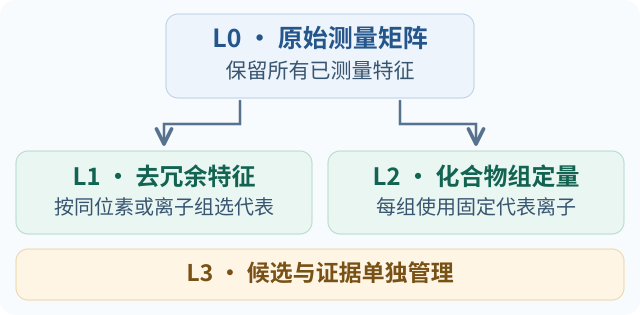

# 特征注释

[文档导航](README.md)

使用 m/z 特征表或定量矩阵。在「候选与关系审核」定位峰和候选，在「证据与导入」审阅外部注释和谱图比对，在「定量视图」选择统计输入。

[查库与审核](#候选与关系审核) · [选择数据库](#可选数据库与二级匹配状态) · [查库参数](#脂质查库与同位素参数) · [谱图证据](#证据与导入) · [归组与定量](#离子归组与化合物证据) · [排错](#注释排错)

## 候选与关系审核

服务器启用注释方法时，页面用「插件方法」为所选实测来源生成候选版本。结果进入同一审核流程，可查看和导出。
离子归组及定量视图通过主流程使用。[方法输入与产物](method-plugins.md#可接入类型)

1. 选择当前矩阵或导入特征表。只有 m/z 或强度来源未知时，可使用「仅精确质量候选」。
2. 在「查找候选」选择数据库、极性、加合物及质量容差。需要天然同位素或相关证据时，核对强度来源。库内二级参考谱可用性与本次比对状态分别呈现。
3. 在谱图点选峰、检查重叠峰与候选，结合来源和关系审阅。确认、否定或撤回均保留记录。完成后主动保存项目，移交完整审阅时导出交换包。

## 查库、版本与注释图表

进入「特征注释 → 候选与关系审核」。顶部显示谱图来源、当前统计输入、有效注释及归组版本。
普通定量项目使用当前特征数据。关联测量根的 L1/L2 可回看 L0 全部实测 m/z。仅源 L2 项目可查 EC 中性质量和定量映射，
完整谱图需要可访问的实测峰或独立 m/z 表。

左栏按特征 ID、m/z、候选名和状态找峰，中间显示局部谱，右栏核对候选、峰关系、证据和审核记录。
随时可「查看完整谱图」，包括查库前、无候选及未归组的峰。点峰按来源与稳定 ID 定位。
重叠峰列出精确 m/z、ID 和强度供选择。列表过滤不裁减全谱。缩放、复位和返回局部保留当前选择，
同一来源和样本保留局部及全谱的各自视野。图的强度样本只影响显示。

点击「查找候选」配置搜索；成功后回到审核。独立特征表可以查精确质量；天然同位素比例和相关证据需要可用的未变换强度。
显示和导出筛选、完整天然同位素关系及分类和网络图按需展开。

1. 选择主数据库及可选附加库，检查数据库来源与版本。内置哺乳动物细胞和藻类候选库可直接使用；使用 LMSD 且配置目录没有 SDF 时，“准备数据库”或首次运行从 LIPID MAPS 下载 LMSD；
   已有库校验后复用，损坏文件不会被静默替换。目录配置见[部署说明](deployment.md#脂质数据库)。
2. 选择实际极性、加合物、注释质量容差，核对用于比例计算的未变换强度层和采集分辨率。
   所有容差内候选保留，精确质量只提供候选注释。参数及规则文件格式见[参数说明](#脂质查库与同位素参数)。
3. 可导入 JSON/CSV 评分规则，预览后由管理员保存为命名预设；也可选择已保存预设。没有自动启用的内置分值。
   规则审阅草案及完整分值见[规则文件夹](../rules/lipids/README.md)，安装包默认提供五份可选预设，名称带“审阅草案 v1”；选择后仍须运行或应用排序。
   点击“运行注释与同位素标记”生成独立版本，
   特征轴、矩阵、SNR 和已有数值分析保留。重复运行生成新的注释版本；在版本列表查看历史结果，用“设为当前注释版本”应用选定版本或返回未注释状态。
4. 候选逐条显示，先按绝对 ppm 三档、再按网络支持等级、最后按档内规则分排序，同档同等级同分并列，不拼接名称。
   可逐特征选择候选并保存人工指定，或恢复规则推荐；导出“首档最高分及并列项”时，已有人工指定优先。
   天然同位素关系按候选来源及样本逐条展示，可接受、否定或恢复待核对；自动命中不删除峰。
   两张表分别选择排序条件与升降序，对全部结果排序后分页；缺失值最后。同位素样本按显示名排序，
   误差可选择绝对值或带符号值，候选表逐条对应数据库记录。
   显示排序不改写规则推荐、评分或人工指定；候选与关系 CSV 沿用各自排序，仍导出全部适用记录。
5. 显示/导出可组合类别层级、候选范围、同位素状态和加合物保留方式。三种加合物模式为全部、每种物质最强、仅指定。
   最强按各样本平均强度再等权平均，为全部细胞固定选择一列；只有相同物质 ID 或相同完整候选 ID 集合才归为一组。
   同分子式不直接合并，歧义分组不同的峰分别保留；强度相同按稳定 ID 决定固定列。未注释峰默认保留，可关闭。
6. 筛选矩阵 CSV 保留当前矩阵的完整数值精度及稳定特征 ID；候选明细按物质逐行输出名称/分子式/加合物/评分，
   完整同位素 CSV 保存母子关系及比例证据，可通过 feature ID 对应矩阵。下载不受当前特征或分页限制，
   同位素关系下载始终完整，以便审计隐藏的峰。用户筛选只作用展示和下载，不改当前矩阵。
7. 主动保存项目以保留版本、规则和核对进度，打开项目后可继续审阅和导出，无需数据库在线或重跑。
   修改评分只重排；细胞/特征、分组或强度来源变化使旧版本过期，过期版本不能下载。
   使用不变输入层时普通归一化不重跑注释；恢复完整预处理起点回到起点的注释状态，不是撤销最后一次人工选择。

### 注释图表与相关网络

谱图高亮选中峰及相邻同位素或加合峰。峰标签默认同时显示注释名称和 m/z，可切换为单项。右侧证据显示来源库有谱、无谱、未提供信息与实测比较状态。
人工显示名称与候选可同步已确认关联组，冲突成员保留待定。点峰及保存关联更新当前对象和图层，页面停在原审核位置。
数据库与科学解释见[注释说明](#可选数据库与二级匹配状态)。

运行注释前可展开“相关性辅助注释与网络 · 高级参数”，核对原始输入层、相关方法、阈值、
样本范围及分子网络层；有明确重复分组时主动选择 `condition_field`，未设置时逐样本查看。
修改计算参数须重新运行新版本，不能套用旧版本证据。定义和限制见[分析说明](#候选排序天然同位素与网络)。

“分类与相关网络图表”显示特征数饼图及可切换的两种网络。先应用上方注释筛选，再选择分类层级、
网络、样本/条件，点击“应用图表显示”。高级显示参数提供正负边、节点上限、名称/mz 搜索及类别筛选。
点击节点在审核栏查看候选并人工核对，“展开邻居”只显示该节点及其相邻节点；再次应用图表显示恢复全图。
多义候选不进入分子合并；无歧义分子节点可指定代表离子或恢复自动代表。
边悬停和明细分别提供相关值、共同检出及化学关系，辅助证据表保留逐样本状态和重复共识。

可下载饼图/网络 SVG、PNG、计数表及完整节点/边 CSV、图表和证据 JSON、辅助证据 CSV。
节点上限只影响图片显示，表格和 JSON 导出不截断节点；注释筛选、搜索、类别和邻居范围仍适用。
两类网络的标题和导出注明强度层、方法、样本/条件。点击“保存图表设置”把显示参数及当前注释筛选
加入工作区，再主动保存项目；重开后恢复该设置。原始图表数据、逐样本证据和人工代表随注释版本保存，
无须在线数据库或重跑。人工候选/同位素审核更新标签、计数、支持等级及分子映射。

## 可选数据库与二级匹配状态

独立特征表和强度来源未知的外部矩阵可使用“仅精确质量候选”模式，按稳定 ID 与 m/z 检索并人工审核。
需要原始强度的同位素比例与相关证据由具备相应来源的强度层计算。谱图标明当前层及矩阵值来源，
相对丰度切换仅对具备适用强度语义的非负数据开放。

注释板块可选择本地 LMSD 文件、内置“哺乳动物细胞数据库”“藻类数据库”及附加库。多库结果保留各自文件摘要、记录 ID、
版本和来源，不因同名、同分子式或相近质量而强制合并。已有注释保存完整候选，重开不要求原数据库在线。

哺乳动物细胞预设来自用户提供的 `脂质注释_20261117_115527.csv`：原表 791 个峰，121 条带名称观测整理为
88 个“名称＋中性分子式”候选，保留对应观测、原始备注和整理报告；670 条未命名峰不提升为化合物记录。
中性单同位素质量按所给分子式计算，实测 m/z 只作来源观测，不作为中性质量；同式不同名保持独立。
预设名称表示用户指定的使用场景，附件没有提供物种验证或二级谱图匹配依据，相关字段明确记录未提供。
源备注仅保存为数据，不自动转成筛选或鉴定规则。

在「特征注释 → 查找候选 → 脂质数据库文件」选择「藻类数据库」。该预设来自用户提供的
`table S1(1).csv`，保留全部 251 条正离子参考，只按原表所列加合物和理论离子 m/z 匹配。
原表说明该理论列由实测 m/z 和所列 ppm 误差反推。
要覆盖全部记录，除默认四种正离子加合物外，还需勾选 `[M+H-H2O]+` 和 `[M]+`（原表写作 `M+`）。
每个原表编号对应一个独立条目。候选详情和 CSV 保留原表实测 m/z、ppm 误差、注释等级和 MSI 置信级别。
附件仅提供二级注释标签，未附参考谱。即使原表标为 `MS2 matched`，当前项目的二级状态仍由实际谱图证据决定。
9 条参考的理论 m/z 与按表中分子式和加合物计算的值相差超过 10 ppm。网页标记这些条目，允许查质量候选，并跳过天然同位素计算。

谱图标签可显示候选名称和 `MS2` 状态：`Not supplied` 表示来源库未提供，`Unknown` 表示无法确定；
`Available` 表示库中有可用二级参考证据；实测谱图按实际检索结果标为 `Matched` 或 `No match`。
`No spectrum in database` 表示来源记录明确声明未收录二级谱。库内参考谱可用性与实测谱比对状态分别保留。
`Mixed` 表示同峰的多个候选状态不同，展开候选查看各自结果。
MS1 质量命中、天然同位素或加合关系不等于 MS2 匹配通过，也不等于已确认结构。
多库候选按各自来源显示状态，不能用某个库的结果替换其他库的未知信息。

### 谱图与人工联动审核

注释谱图按稳定特征 ID 关联峰、候选和关系。定量数据以所选样本/全部样本的特征平均强度展示，
独立特征表只显示 m/z 位置并标明强度未提供；两者均不冒充单扫描原始谱。
「查看完整谱图」读取所选来源完整峰轴，独立于查库、归组和统计分支。已关联测量根的定量分支可回看 L0；
仅源 L2 的中性质量由定量视图展示。峰位重叠时分别提供稳定 ID、原精度 m/z 和可用强度。
点击峰高亮关联成员，图与候选表双向定位；人工可接受、否定或恢复待审核的同位素/加合关系。
保存候选与人工显示名称默认同步已确认关联组，可选择仅当前峰；各成员保留自身加合形式和同位素序号。
共享或多义峰保留候选及冲突，不从整张关系图强制推导唯一化合物。一次保存原子发布所有受影响记录，
保留审核人、时间、修改前后和组成员；实测 m/z、矩阵强度不变。
谱图导出同时核对数据、注释版本及审核修订，审核改变后须重新读取谱图；完整审核随项目和模块交换包保存。

### 原始谱重叠复核

1. 在有效注释版本中，分别定位母峰和竞争峰，在各自候选旁点击「选入原始谱复核」。可从任一峰开始，两个候选需同极性且有可计算的中性分子式与加合物。
2. 点击谱图工具栏的「原始谱复核」，选择项目原始文件和一条 MS1 连续谱。扫描索引从 0 开始，可先在「细胞提取 → 原始预览」核对索引和原生扫描号。半高宽（Da）留空时由同一条扫描的母峰估计，也可填入已测值。模板质量偏移默认 0 ppm，有校准依据时可填入。
3. 「运行并记录复核」比较母峰天然同位素模板和加入竞争单同位素离子的双组分模板，显示母峰区、重叠区、实测谱、残差和竞争组分峰高。点击「打开证据记录」复查原扫描号、候选、参数和曲线，可下载完整 JSON。主动保存项目后可再次打开记录。

此比较使用同一条连续谱的原始强度、精细天然同位素及两个局部背景项。模型使用高斯峰形与非负最小二乘，
在选择的半高宽下拟合两个窗口。质量差显示所选同位素阶的最丰组分，拟合仍使用窗口内的细结构。
相对 RMSE 以本次局部谱最大强度为分母。模板扰动范围来自质量偏移 ±1 ppm 和宽度 ±10% 的单因素变化，
用于看峰高是否对模板敏感。母峰信号或连续谱采样不足时显示无法评估。所得峰高是条件模型结果，
化学身份仍以审阅证据为准。矩阵特征在细胞窗口内各自取峰，复核需使用同扫描原始谱，适用范围记录到证据。

## 候选排序、天然同位素与网络

同位素比例、相关性辅助及 m/z 特征网络只接受明确记录为未归一化、未插补的强度层。
分子网络另可使用有可靠来源的 `total`/`max`/`pqn` 归一化层；插补或其他变换后的层不能作为这些强度证据。
旧 H5AD/项目没有可靠溯源时标为未知，仍可导入、常规分析和保存，但不会提供为可选证据层，
也不能通过 reset、恢复层、非负值或原始层名称变成 raw。存储与恢复规则见[强度溯源](internal-reference.md#强度溯源)。

网页先以一级精确质量搜索所选数据库，保留所有匹配。绝对 ppm 的三档优先于网络支持等级，最后按档内类别/加合物规则分排序；
规则只提供排序证据，不把首位候选解释为结构鉴定，不删除并列候选，也不把名称拼接成一个物质。
人工指定和规则推荐分别保存，完整候选始终可审阅。

使用固定依赖版本的 OpenMS 元素表与精细天然同位素分布，纳入加合物原子组成（包括 K 的天然同位素）。
同一 nominal 阶数内，按采集分辨率估计的一个 FWHM 合并理论细结构，使用概率加权中心和合计概率；
以观测母峰 m/z 加理论间隔定位对应特征。该近似处理分辨能力，不模拟 FTMS 相位干扰或分解混合信号。
计算保存 OpenMS 版本及截断尾概率 `1e-6`，不使用旧 API 的最大碳数估算和手工碳丰度参数。

每个样本在共同有效细胞中计算 `R_observed = sum(I_child) / sum(I_parent)`；母峰为正、子峰非负，零子峰参与统计。
与理论 `P_k/P_0` 比较，默认落在理论比例的 80%～120% 且有效细胞数达到门槛时标为命中。
质量/比例边界保留 float64 计算；比例比较只为机器舍入加入极小保护，不放宽实验容差。
样本分别记录，允许同一个峰同时拥有独立物质候选及多个同位素来源，不进行贪心唯一分配。

不同不饱和度脂质与同位素可形成仪器无法分开的混合峰，比例通过不证明信号只来自同位素。
本功能只标记、审阅及筛选输出，不删除、求和或校正实测强度；精确质量无法恢复 MS1 不能区分的结构信息。
操作见[注释与同位素](#查库版本与注释图表)，参数/规则见[参数说明](#脂质查库与同位素参数)。

相关性辅助遵循“精确质量候选 → 分样本相关 → 化学关系检查 → 支持等级 → 排序 → 人工审阅”。
全细胞保留零值，另计算双方原始强度 >0 的共同检出相关、数量和比例；常数向量或共同检出不足为不可评估，
不作为反对证据，不进入重复共识分母。不同样本细胞不混算，不推断条件；条件共识分别记录支持比例、支持样本、
未支持及方向冲突，不以相关平均值掩盖不一致。同条件复现性不能替代生物重复统计推断。

首版化学支持限同一数据库候选的不同加合物（各自满足本版本精确质量容差）及母峰/天然同位素峰
（本版本质量间隔、分辨率及理论比例检查）。化学关系和两个正相关阈值同时满足才支持候选。
单一来源去重，不递归传播、不加权汇总：等级为 0 无可用支持、1 单样本支持、2 同条件重复支持；
无支持不扣分、不删除，重复不一致另标。同分子式异构体不能据此区分结构，同类/同系物共变仅作探索。
人工否定同位素关系后，该关系不再提供化学支持；人工接受仍不能跳过质量/理论比例与相关检查。

注释分类饼图默认按 `MAIN_CLASS` 统计当前筛选特征，每个特征一次；人工选择优先，
同类别多个候选归该类、跨类归“多义”、无候选归“未注释”，标题显示候选模式及分母。
m/z 网络每个稳定 feature ID 一个节点，显示候选/类别/审核状态，边保留逐样本全细胞与共同检出相关，
另标加合物/同位素关系。绘图有边不必然支持注释，圆形布局无距离含义。

分子网络仅依据人工单选或完整候选身份唯一的稳定数据库 ID 合并；名称相同或排序第一不消除歧义。
代表离子先按各样本等权检出率，再按等权原始平均强度选择，最终按稳定 feature ID 破同分；
整个项目固定一列，可人工指定，不随显示范围或样本换离子，也不相加不同加合物。
分子与 m/z 网络的强度层不同，边可以不同；默认分子网络反映 `total` 后相对丰度共变，负相关需考虑总量约束。
条件网络要求同方向的绘图边满足重复共识，仍显示各支持样本的边；逐样本结果完整保留。
参数见[相关性辅助与图表参数](#相关性辅助与图表参数)。

此前的质量/同位素规模检查使用下载的数据库与合成矩阵，原始机器证据为
[3,000 × 500](validation/lipid-annotation-synthetic-3000x500.json)和
[10,000 × 500](validation/lipid-annotation-synthetic-10000x500.json)，复现命令见[开发指南](development.md#脂质注释规模检查)。
这些报告不表示实验准确率或用户验收；用户已选择自行手动验证。

## 脂质查库与同位素参数

“特征注释”板块的“注释与同位素”可选择本地 LMSD SDF 或内置数据库，保留所有容差内候选，不限制最近候选数。
主数据库由 `database` 指定，`databases` 为附加库列表，跨库来源分别保留；可选预设及二级状态见[数据库说明](#可选数据库与二级匹配状态)。
正模式支持 `[M+H]+`、`[M+Na]+`、`[M+K]+`、`[M+NH4]+` 和显式选择的 `[M+H-H2O]+`，负模式支持 `[M-H]-`、
`[M+Cl]-`、`[M+HCOO]-`、`[M+OAc]-`。采用单电荷天然丰度模型。失水形式按其原子组成生成质量候选，示踪、多电荷和一般源内碎片需其他证据处理。
极性和所选加合物需与实验一致；`both` 搜索两组候选，不推断实际采集极性。
网页从元素质量与电子质量计算离子质量，甲酸/乙酸加合物按实际原子组成计算；不沿用旧 API 的近似加合物常量。

| 参数 | 网页默认值 | 含义 |
|---|---:|---|
| `annotation_ppm` | `10` | 实测与理论离子 m/z 的绝对相对误差上限；保留全部命中 |
| `isotope_ppm` | `10` | 预测同位素与观测特征的 m/z 匹配容差 |
| `max_isotope_order` | `3` | 检查 M+1～M+3；可选 1～10 |
| `isotope_tolerance` | `0.2` | 实测/理论强度比例的双侧相对容差；0.2 为理论比例的 80%～120% |
| `min_valid_cells` | `20` | 每样本最少有效细胞对数；母峰 >0、子峰 ≥0、双方有限，子峰零值参与统计 |
| `intensity_layer` | 项目的预处理输入层 | 使用未归一化、未插补强度；只开放有未变换/未插补溯源的输入层及 `X`，SNR 和未知溯源层不作为辅助证据来源 |
| `resolution` | 当前项目参数值，使用前核对 | m/z 200 处的分辨率，沿已有提取的质量缩放定义估计理论细结构合峰。强度证据模式需明确正数，仅精确质量模式可省略 |
| `sync_related` | `true` | 人工指定默认同步已确认关联组；推测关系不直接参与传播 |
| `mass_only` | 有可用原始强度层时 `false` | 独立特征表或来源未知矩阵可选仅精确质量候选，跳过天然同位素比例和相关计算 |
| `annotation_name` | 无覆盖 | 人工显示名称；保留各峰的加合形式与同位素序号，不覆盖实测数值 |

导入 H5AD 的输入层不保证就是原始强度，需按数据来源核对。比例按样本的有效细胞总强度比计算；
优先使用稳定 `sample_id`，否则使用 `sample`/`source_file`；没有分组字段时标为单样本。
样本间一致性、母峰未检出而子峰检出的数量均可审阅，不增加自动删除/强制保留门禁。
自动标记按每条候选关系和每个样本分别记录；显示/导出隐藏同位素时，默认使用任一样本命中且未被人工否定的关系，
也可只使用人工接受关系。评分不改变这些计算证据。

`ppm_error = (observed_mz - theoretical_mz) / theoretical_mz * 1e6`；正数表示实测偏高，
`abs_ppm_error` 取其绝对值。排序先按 `≤2`、`>2 且 ≤5`、`>5` 三档，再按网络支持等级、类别分＋加合物分降序；
分档使用完整精度，同档同分保留并列，不再按更细的误差差异择优。未导入规则时同档候选未评分。

### 相关性辅助与图表参数

以下为用户接受的初始预设，尚需真实数据检查；不是鉴定概率或通用最优阈值。
高级计算参数收起展示，改变后须重新运行并生成新版本；显示设置不改变证据计算。

| 参数 | 默认值 | 含义 |
|---|---:|---|
| `method` | `spearman` | 可选 `pearson`；各样本内计算 |
| `support_all` | `0.8` | 保留零值的全细胞相关下限，辅助注释只接受正相关 |
| `support_joint` | `0.7` | 共同检出细胞相关下限，须与上一条件同时满足 |
| `min_joint_cells` | `30` | 每对特征每样本最低共同检出数；检出始终按原始强度 >0 |
| `plot_threshold` | `0.7` | 绘图全细胞绝对相关下限；同时要求共同检出足够且两种相关可评估 |
| `consensus_fraction` | `2/3` | 同条件可评估样本的支持比例下限 |
| `min_support_samples` | `2` | 同条件最低支持样本数 |
| `condition_field` | 空 | 必须明确选择样本级条件字段；同一样本内唯一且非空；未设置时只提供逐样本结果 |
| `samples` / `conditions` | 空列表 | 全部样本/条件；明确指定后只计算所选范围 |
| `molecule_layer` | `total` | 从 `intensity_layer` 的完整输入特征集合派生每细胞总量归一化；可选原始或有未插补强度溯源的已有 `total`/`max`/`pqn` 层 |
| `classification_level` | `MAIN_CLASS` | 可切换 `CATEGORY`/`SUB_CLASS`，按特征计数 |
| `graph` / `scope` | 特征网络 / 首个样本 | 可切换分子网络和指定样本；设置条件后提供同方向重复共识视图 |
| `sign` | `both` | 正边、负边或两者；颜色和线型分别标识 |
| `node_limit` | `100` | 1～2000；仅限制显示，证据和节点/边表导出不截断 |
| `search` / `category` | 空 | 节点 ID/mz/候选名称搜索及类别显示筛选 |
| `representative_feature` | 自动 | 检出率优先，再按原始平均强度破同分，两者均各样本等权；可人工指定该无歧义分子的特征 |

注释辅助与 m/z 特征网络共用未变换、未插补原始强度；天然同位素比例仍使用该原始层。
旧 H5AD/项目没有可靠溯源时允许常规分析，但不提供为上述可选强度层；reset/restore 不改变来源定义。
具体兼容与恢复规则见[强度溯源](internal-reference.md#强度溯源)。
分子网络 `total` 的分母在本次输入的完整特征集合上计算，不随候选、代表离子或显示筛选重算，
也不覆盖当前 `X`。已有层按其完整溯源使用，不因数值相似而假定匹配当前原始输入。
导入初始层是否真实原始强度仍须由使用者核对；系统无法从数值逆推导入前处理历史。

### 评分规则文件

默认提供 PBMC、人癌细胞、小鼠癌细胞、藻类、大肠杆菌五份可选规则预设，须主动选择并应用。JSON 根对象包含 `schema_version: 1`、可选 `name` 和 `rules` 列表。
每条规则字段为 `kind,level,value,polarity,adduct,score`；未知字段、非有限分值、重复条件和极性冲突拒绝导入。
`kind=class` 指定类别分；`kind=adduct` 指定加合物分，可用类别条件限定。
类别 `level` 支持 `CATEGORY`、`MAIN_CLASS`、`SUB_CLASS`、`LIPID_CLASS`；`value` 使用数据库类别名称/代码，
或缩写中的类别如 PC。较具体层级覆盖同一评分项的通用规则，不重复累加；同层级优先极性明确的规则，
同样具体的多个别名条件按文件中先出现者，评分证据列记录实际采用项。空 `polarity` 适用两种极性。

以下仅演示格式，分值需自行修改；它不是内置预设：

```json
{
  "schema_version": 1,
  "name": "自定义示例",
  "rules": [
    {"kind": "class", "level": "MAIN_CLASS", "value": "GP01", "polarity": "pos", "score": 10},
    {"kind": "adduct", "level": "LIPID_CLASS", "value": "PC", "polarity": "pos", "adduct": "[M+H]+", "score": 5}
  ]
}
```

CSV 表头和对应示例：

```csv
kind,level,value,polarity,adduct,score
class,MAIN_CLASS,GP01,pos,,10
adduct,LIPID_CLASS,PC,pos,[M+H]+,5
```

导入先校验并预览，点击应用排序或运行后才成为该版本的规则。命名预设主动保存，拒绝同名覆盖；
全局预设不追溯更改既有版本。正负模式的规则可保存在同一文件中，模板不包含评分项。

供人工审阅的 PBMC、人癌细胞、小鼠癌细胞、藻类及大肠杆菌草案位于
[规则文件夹](../rules/lipids/README.md)，附完整分值和原始研究依据。它们随安装包提供，新环境无需手动导入；
须主动选择预设或导入文件、预览及应用；同名用户预设优先保留保存值。分值是排序建议，不能解释为丰度或鉴定概率。

## 证据与导入

「证据与导入」接收 CSV/TSV 注释表。显式指定匹配列及目标字段，或显式按当前特征顺序匹配；支持转置。预览显示匹配、歧义、未匹配数量；一对多歧义阻止应用，不自动改用位置。未匹配项默认保留旧值，也可明确选择清空。字段映射示例：`name=manual_annotation`；科学字段和稳定编号不能覆盖。

MS/MS 搜索可导入带前体质量的实测 MGF/MSP，或选择项目已登记的 mzML/mzXML 文件。使用项目文件时填写 0 起始的扫描索引范围，包含首尾，结束留空时读到文件末尾。参考谱库使用 MGF/MSP。填写样本池、极性及已知仪器/碰撞能后运行。逐条打开比对可查看两个碎片谱及误差；实测未过阈值的前体命中仍可打开。点击特定峰、候选或组的证据入口可带入对象，核对版本和样本池后明确保存关联。撤回记录保留审阅历史。主动保存后可从证据列表重开每次搜索，并下载比对谱、匹配数据与谱库摘要。标准品、空白、经验和群体谱可登记来源、类型和适用范围；鉴定等级独立声明。

### 外部注释与 MS/MS 候选证据

外部注释表必须显式声明按键或按位置对齐，不存在自动位置回退。一对多匹配阻止写入，未匹配项的保留/清空由用户选择；不覆盖 m/z、稳定编号和筛选/科学内部字段。当前输入为 CSV/TSV，可按首列字段名转置。

MS/MS 搜索在实测与参考谱的前体质量容差内比较谱图，碎片先按质量排序，再将所有容差内候选对按绝对质量差排序，贪心取得一对一匹配。分数为匹配碎片 sqrt(I_observed*I_reference) 的和，除以两谱总强度乘积的平方根；未匹配碎片仍进入分母。相似度达到阈值且碎片数达标才标为通过，全部命中前体的候选与扫描仍保留。

项目文件逐扫描处理。明确为连续谱的扫描独立质心化，质心谱直接参与匹配。文件缺少谱型时，可按采集记录填写已知谱型。搜索只纳入具备一个有效前体和可用碎片的 MS2 扫描。
记录保存文件摘要、原生扫描号、索引、前体电荷、隔离窗两侧偏移、采集极性及碰撞能，无法读取的字段标为未提供，跳过情况随记录保存。
Thermo RAW 的二级比对可通过保留前体元数据的 mzML/mzXML 或实测 MGF/MSP 提供。

文件有明确极性时，实测谱与声明矛盾会拒绝，参考谱极性不符则不参与比较；缺失极性不能被推断为已经核实。样本池、仪器和碰撞能按用户提供的信息保存，不猜测缺失实验条件。该分数未经身份错误率校准，不作鉴定概率，不与现有天然同位素证据加权成一个已校准结论，不自动指定首位候选。

比对记录保存完整实测与参考谱、引用身份、碎片对和阈值结果。人工关联绑定来源、目标版本和确切谱对，保存样本池、理由和时间；撤回保留历史。库中有谱、实测比对通过及人工采用各自记录。

当前保留现有 MS1 候选、同位素和人工断言体系；不移植上游自动汇总名称后替换候选的行为，也不使用上游 Python.NET reader 替换本服务的 profile/float64 RAW 协议。真实 MS/MS 适用性仍需标准品及有明确采集条件的数据验证。

| 参数或控件 | 网页默认 | 含义与约束 |
|---|---|---|
| 手工注释 ppm | 5 | 仅按 m/z 对齐时使用，以导入表参考质量为分母；按键匹配不自动选择最近候选 |
| MS/MS 前体 / 碎片 ppm | 10 / 20 | 前体匹配以参考前体质量为分母；碎片一对一贪心匹配，包含质量容差端点 |
| MS/MS 最低分数 / 匹配碎片 | 0.5 / 3 | 分数为平方根强度余弦；阈值只标记通过与否，未通过记录仍保留 |

## 离子归组与化合物证据



在「候选与关系审核」打开「生成离子关系」或在峰关系中进入离子组审核。定量视图管理来源与统计分支。
启用目录时冻结完整预处理起点，保留已有分析。导入数据须明确选择起点数值空间，未知数据不能自动认证为线性。

1. 选择测量来源、采集极性、离子形式及质量容差，后台生成关系与竞争解释。天然丰度正/负离子分开执行；默认 5 ppm，可按实验调整。
   已有分子式的条件同位素证据还需实际采集的 m/z 200 分辨率，不从 QE 型号猜测。
2. 查看关系、候选 EC、角色解释和搜索诊断。表格每页 100 行，完整 JSON 下载不截断。选择 EC、明确选择一个角色解释，在组内关系行勾选支持关系并填写理由，
   点击「接受所列关系与此组解释」。服务同时核对共同质量区间、角色、电荷、槽位、全组连通及重复计量，冲突不发布。
   失水/源内碎片候选可查看，不会直接归并。没有足够证据时保留单例和歧义。
3. 在「定量视图」预览细胞与变量数、保留或省去的峰、固定代表和不可量化原因。默认「仅人工接受且符合硬约束」构建 L1/L2；探索模式尚未实验校准。
   L1 可按同位素或整离子组去冗余；L2 使用固定代表离子，支持人工指定，不加总不同加合物。
   选择保留未知单例时，未知信号无需获得化学身份即可分析。
4. 选择 L0/L1/L2 分支并点击「作为统计输入」，然后进入预处理或分析。预览和构建保留此前的统计输入。各分支独立保存历史、结果与模型运行身份。
   缺测源 L2 需先选择固定细胞或固定变量，预览共同可量化子集，再物化分析分支。源中 NaN 是不可量化，0 是测量未检出。
5. 在「查找候选 → 使用本地化合物库」载入 JSON/CSV/TSV/SDF，填写命名空间与字段映射，选择实测峰 m/z 或已审阅离子组中性质量及已有分子式。
   通用化合物候选保留独立的参数、版本和排序。证据和鉴定声明在「证据与导入」操作。

任务列表显示中文状态；可刷新页面查看。点击橙色“取消任务”会终止计算并核实 worker 退出。计算期间改变输入或项目修订时，结果保留但不能收集，需明确重新运行。
任务状态不是科学置信度，搜索完成也不表示归组已验证。维护会停止局部任务，重启不续算。

来源视图导出为单 H5AD；完整离子项目导出 ZIP 包含全部来源/分支/映射/托管证据，不含可执行模型，原始谱保持外链。
完整包导入需空项目，单源 L2 可独立导入且不伪造 L0。正式项目保存仍需主动点击保存，页面构建视图不自动写正式快照。
EC 合并在离子页显式选择来源与对应/可比性映射，同质量或名称不自动对齐；不同响应体系须有校准依据才能合并。

敏感性比较只读取已有分析，要求细胞 ID 顺序一致。共享归一化需各分支先应用同一逐细胞分母；独立归一化报告各自变量宇宙。
按样本/重复汇总 CSV 只生成描述汇总，不执行重复水平推断。当前细胞级检验不把单细胞数当作生物重复。

### 离子关系与表示参数

新离子页与 `scMM.ion` 独立于旧 `deisotope/get_annotation` 的参数及默认值。

| 参数 | 网页初始值 | 含义 |
|---|---|---|
| polarity | pos | 明确按正/负采集极性分别归组 |
| ppm | 5 | 相对预测 m/z 的质量容差；经验偏差偶到 10 ppm 时由用户调整，不自动扩大 |
| species | H、Na、K、NH4、失水加氢 | 元素组成与带符号电荷定义；失水形式保留候选，不直接归并 |
| max_isotope_order | 3 | 自然丰度碳同位素候选阶数，非示踪丰度校正 |
| min_valid_cells | 20 | 每样本比例证据的最低可评估细胞数；不足记录不可评估 |
| resolution_200 | 未填写 | 有公式的同位素精细结构需明确实际采集分辨率，参考 m/z 200 |
| mode | reviewed_v1 | 仅人工接受且通过硬约束；exploratory_v1 为未实验校准规则模式 |
| strategy | isotope_representatives | L1 每个离子形式保留同位素代表；可选择整组代表 |
| include_singletons | true | 保留未知单例，L2 标明其未归组状态 |
| quantification | fixed_representative | 固定单体代表离子，按样本等权检出率/响应排序，稳定 ID 破同分；支持人工指定 |

不同加合物响应不相加。同位素未知起点允许 0～3 的角色备选，不自动选择单一中性质量。
QE/Orbitrap 的本地分辨率使用 `R(m)=R200*sqrt(200/m)`，FWHM 为 `m/R(m)`。使用实际采集设置；提取界面的默认分辨率仅是软件初始值。
依据：[Thermo Exactive 系列手册](https://documents.thermofisher.com/TFS-Assets/CMD/manuals/man-bre0012255-exactive-series-manbre0012255-en.pdf)、[Q Exactive 技术论文](https://pmc.ncbi.nlm.nih.gov/articles/PMC3284220/)。

离子 worker 的状态/时间/内存预算属于运维配置，见[部署说明](deployment.md#离子后台资源)。预算不是实验阈值或错误率。

### 离子视图与定量空间

内部多视图分析在活动分析分支执行，结果携带 root/view/branch、数据修订、输入数值摘要及数值空间。
同一数值矩阵的不同分支仍有不同运行身份。含 NaN 的源 L2 必须先固定细胞轴或变量轴，
预览共同可量化子集，再物化有限分析分支；0 表示未检出，不代替不可量化。

差异比较与统计 Marker 支持 `effect_layer` 和 `test_layer`：前者计算均值及 Fold Change，
后者进行检验，可以采用 log 或标准分。已知非线性空间不能计算原丰度 FC；
新视图要求效应量输入明确为 `linear_abundance`。旧 Python 调用若缺少数值声明，
保留旧调用行为，但返回的输入说明标记 `legacy_unverified_abundance`，不认证其科学含义。
兼容参数 `layer` 同时指定两种输入，不得与新参数混用。分类器 Marker 仍只接受 `layer`。
细胞是现有检验单位；生物重复推断不能用细胞数量替代。

`application.analysis_inputs.replicate_summary` 按显式重复键导出均值、中位数或总量及细胞数，
不自动运行重复水平检验。`compare_views` 只比较已存在的分支结果，要求细胞 ID 与顺序一致，
报告变量宇宙、归一化来源、已有 PCA 参数/方差、差异结果及聚类 ARI。
共享归一化需先调用 `apply_shared_normalization`，逐细胞提供明确分母，各分支记录同一分母后方可声明共享；
独立归一化明确使用各分支的变量宇宙，不能解释为相同定量基准。
参数不一致会保留诊断，不自动重算分析。PCA 从变量矩阵直接计算时还保存变量载荷。

启用目录时可保留与完整预处理起点相符的现有分析、模型及用户图。样本元数据按稳定
`sample_id` 同步全部分析分支及其重置起点，历史测量根与来源保持不可变。
化学身份信息在目录中追加，不修改数值矩阵；EC 的中性质量不能作为 m/z 输入旧脂质搜索。
监督模型的 holdout/CV 不消除上游表示选择或预处理泄漏，不能据 holdout 表现挑选视图后再宣称独立测试。

#### 离子归组的方法参考

- [khipu 作者代码](https://github.com/shuzhao-li-lab/khipu)：借鉴 empirical compound 和离子关系，不直接替换现有算法或继承 RT 前提。
- [Detectable khipu](https://link.springer.com/article/10.1007/s11306-026-02456-y)：LC-MS 证据不能视作 CyESI 归组性能。
- [IIMN](https://pmc.ncbi.nlm.nih.gov/articles/PMC8219731/)：借鉴关系图和折叠/未折叠表示，不把折叠强度相加当本任务的化合物定量。
- [What's in a name](https://pmc.ncbi.nlm.nih.gov/articles/PMC12886295/)：数据库质量命中和身份鉴定分开报告。
- [单细胞蛋白组学建议](https://pmc.ncbi.nlm.nih.gov/articles/PMC10130941/)：借鉴对照、定量与不确定性评价，不移植鉴定 FDR 模型。

规则脂质用 Goslin 标准化总组成显示。PC(16:1/18:0) 和 PC(16:0/18:1) 可折叠为 PC(34:1)，
不同类别、分子式或加合物分别显示；总组成名称保留氧数、醚键和固定同位素等信息。展开可查看和选择原始库条目，
复杂化合物及解析失败的条目按原名显示。
同位素表“查看截谱”按该关系的有效细胞显示局部平均特征谱，并叠加按母峰缩放的理论同位素峰；绿色框自动匹配、蓝色人工接受、橙色待检查、灰色人工排除，线型同步区分。
该证据图明确标为矩阵特征谱；原始谱可另从细胞联动查看。

脂质图像导出在点击时固定当前图形、注释版本、宽度、字号和 DPI。异步绘图/下载期间冲突操作禁用，失败显示在页面错误区，可调整后重试；不再把 PNG 导出异常留作不可见的异步失败。PNG 沿用原有最多 6000 万像素上限，超限在分配画布前拒绝，SVG/PNG 数值精度与 DPI 写入方式不变。网络响应和响应体读取后均复核登录、工作区及来源，过期下载不会生成文件。

## 注释排错

### 强度层列表为空或提示来源未知

旧 H5AD/项目可能没有可靠强度溯源；仍可导入、常规分析和保存，但不能把该矩阵用于要求原始强度的
同位素比例、注释辅助或网络证据。先检查文件是否保留明确来源的原始层；若没有，应从已授权的原始谱
重新提取并审核纳入。重命名层、reset 或重保存不会补出缺失来源，也不能证明该矩阵未经插补。
规则见[强度溯源](internal-reference.md#强度溯源)。

### SDF 注释没有命中

- 确认 `ION_MODE` 与采集极性一致。
- 确认数据库记录含可解析的 `EXACT_MASS`。
- 检查需要的加合物是否在默认列表中。
- 用标准品估计实际质量误差，再决定是否放宽 `ANNOTATION_PPM`。
- 检查观测的是多电荷离子、碎片还是数据库未覆盖的化合物。

### 一个 m/z 有很多候选

这是精确质量注释的正常情况。不要只保留名称而丢弃：

- 加合物
- 理论 m/z
- ppm 误差
- 分子式
- 数据库 ID

使用 MS/MS、标准品和保留时间缩小候选范围。
