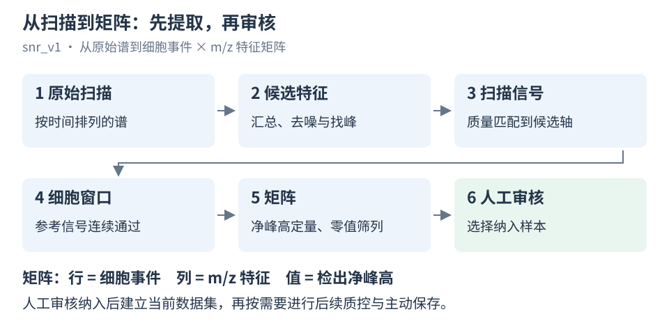
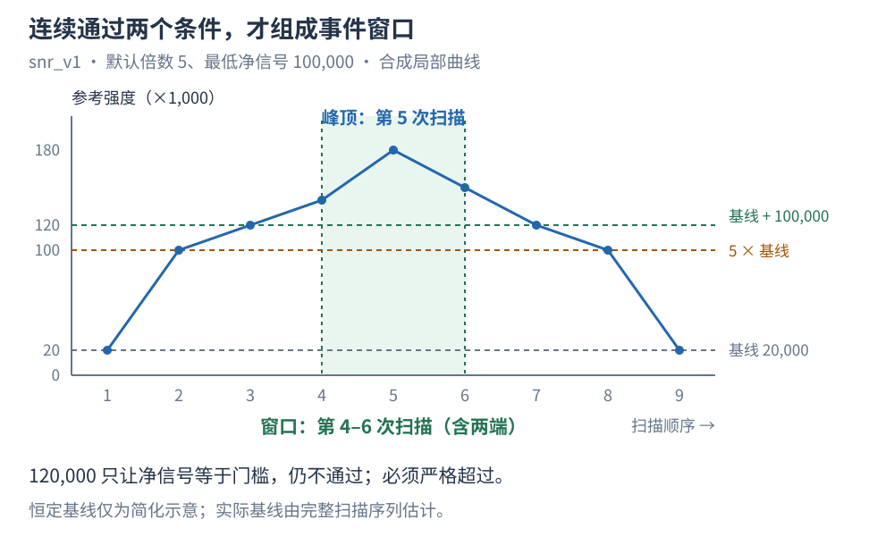
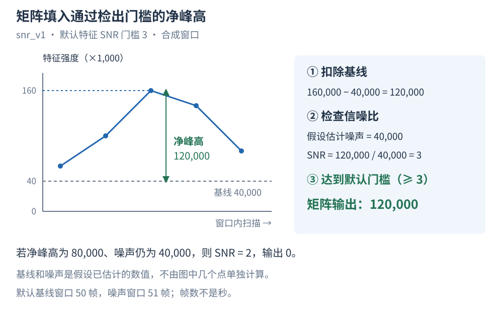

# 从原始谱到细胞与特征矩阵

scMM 先汇总原始扫描谱，找到候选 m/z 特征，再用参考离子的信号识别细胞事件。
随后在每个事件窗口内扣基线、计算特征强度，筛去零值过多的特征。
你审核并纳入样本后，才建立用于后续质控和分析的当前矩阵。

本文面向首次使用的实验人员，只说明网页使用的 **SNR 提取（`snr_v1`）**。
示例采用软件初始默认参数，信号数值为合成数据。已有项目、全局预设或本地配置可能不同，请以实际应用值为准。



*图 1：先提取，再审核。人工审核纳入后，才能对当前矩阵做后续质控。*

## 1. 最后会得到什么？

你会得到一张“细胞事件 × m/z 特征”矩阵：

- **每行**：一个检测到的细胞事件。
- **每列**：一个 m/z 特征，尚不代表已鉴定的化合物。
- **每个数值**：通过检出门槛的扣基线净峰高；未通过时为 0。

输入是按采集时间排列的 MS1 profile 谱，支持 mzML、mzXML 和 Thermo profile RAW。
一个事件窗口不一定对应一个完整细胞，因此矩阵行数首先是事件数，需要结合实验信息审核。

## 2. 开始前要选什么？

### 选择并检查参考离子

参考离子帮助程序识别细胞经过时的信号变化。
先查看它的提取离子流（EIC），也就是该离子的强度随采集时间变化的曲线。

网页初始选中哺乳动物预设，参考 m/z 为 **760.5851**。
这只是软件起点，不能保证适合你的样本；实验者仍须明确选择并检查参考离子。

1. **看样本**：信号是否可检出，尖峰是否符合预期细胞事件？
2. **看空白**：同一离子是否也出现尖峰、高背景或周期性干扰？
3. **看全程和局部**：是否有漂移、饱和或长平台，实际匹配质量是否合理？

不要只因某个离子最强就选它。总离子流（TIC）的波动也不能代替参考离子检查。

### 先认清本例使用的默认参数

| 参数 | 初始默认值 | 用在哪里 |
|---|---:|---|
| 参考质量容差 `reference_ppm_tol` | 10 ppm | 在候选轴上寻找参考离子 |
| 扫描质量容差 `ppm_tol` | 10 ppm | 将扫描谱峰匹配到候选特征 |
| 细胞信号阈值 `cell_snr` | 5 | 参考信号必须超过基线的 5 倍 |
| 最低净信号 `cell_min_signal` | 100,000 | 参考信号扣基线后还须超过此值 |
| 基线窗口 `baseline_filter_size` | 50 帧 | 沿扫描顺序估计滑动中位数基线 |
| 噪声窗口 `noise_window` | 51 帧 | 用附近背景残差估计噪声 |
| 特征信噪比 `feature_snr_threshold` | 3 | 特征净峰高／噪声达到 3 才检出 |
| 最大零值比例 `max_zero_frac` | 0.9 | 保留零值细胞比例不超过 90% 的特征 |

“帧”是扫描数，不是秒；实际时间跨度取决于扫描间隔。
这些是运算示例的起点，不是所有实验的最佳参数。

网页预览使用表单草稿，正式提取使用已应用到项目或样本的参数。
开始前请核对已应用值；完整默认值见[参数参考](parameters.md#网页默认参数)。

## 3. 怎样找到候选特征？

程序汇总扫描谱，估计基线并去噪，再找峰、计算代表 m/z，保留提取范围内的候选特征。
汇总谱用于寻找特征位置，它的强度不是单细胞强度。

汇总谱去噪的默认信噪比门槛为 **10**（`ms_peak_snr_threshold`）。
它与后面识别细胞用的 **5 倍基线**、定量特征用的 **SNR 3** 是三项独立判断。
分辨率、重采样密度和找峰选项也会影响候选结果。

| 特征策略 | 怎样建立候选轴 | 注意什么 |
|---|---|---|
| 共同特征 | 汇总所选输入，先建立共同候选轴，再逐样本提取 | 共同候选不代表每个样本都检出 |
| 独立特征 | 各样本分别找峰，再按合并策略和 ppm 容差对齐 | 并集可为未匹配特征补零；参考轴只保留其匹配范围 |

各次扫描的谱峰匹配到最近、且质量误差不超过 **10 ppm** 的目标列。
同一扫描有多个峰匹配一列时，常规默认取最大强度；显式选择 `sum` 才求和。

例如，目标 m/z 为 **760.5851** 时，10 ppm 约为 **±0.007606 m/z**。
实测 **760.5900** 的误差约为 **6.44 ppm**，在容差内；仍须满足“最近目标”的匹配规则。
参考离子也必须在自己的 10 ppm 容差内找到候选列，否则报错。

增大容差可能混合近邻峰。缩小图上的显示范围，不会改变矩阵的提取范围。
未进入候选轴，也不等于已经检测过却没有该分子。

## 4. 怎样识别细胞事件？

### 每次扫描须同时满足两个条件

程序沿时间估计参考信号的基线，再逐扫描检查：

```text
参考信号／基线 > 5
参考信号 − 基线 > 100,000
```

这里的 **5 是基线倍数**，不是以噪声标准差计算的特征 SNR。
等于任一门槛都不通过；基线接近零时，程序使用正数下限避免除零。

假设某段基线为 **20,000**。第一个条件要求信号大于 **100,000**，第二个要求大于 **120,000**。
因此，这一段必须超过 **120,000** 才通过。基线变化时，判断仍逐扫描进行。

| 参考信号 | 信号／基线 | 扣基线净信号 | 是否通过 |
|---:|---:|---:|---|
| 100,000 | 5 | 80,000 | 否，两个条件均未通过 |
| 120,000 | 6 | 100,000 | 否，净信号只是等于门槛 |
| 140,000 | 7 | 120,000 | 是，两个条件同时通过 |
| 180,000 | 9 | 160,000 | 是，两个条件同时通过 |

### 连续通过的扫描组成窗口



*图 2：合成示例，使用单参考和默认门槛。基线假设已由完整扫描序列估计；图中只展示局部。
点代表扫描，连线仅便于阅读。窗口包含第 4、5、6 次扫描。*

连续通过的扫描组成一个窗口，中间有扫描未通过就分开。
程序不会自动连接邻近窗口，也不会把窗口内每个局部峰拆成细胞。
长平台可能成为一个长窗口，背景尖峰也可能触发事件。

单参考时，窗口内**信号／基线比最大**的扫描是事件峰顶，其采集相对时间记为 `rt`，单位秒。
图中基线恒定，所以峰顶也恰好是原始信号最大处。基线变化时，两者可能不同；并列时取最早扫描。

### 使用多个参考离子时

默认组合方式是 **任一通过**（`reference_mode=union`）：至少一个参考同时满足两个条件即可。
也可选择 **全部通过**（`intersection`）：所有参考都须在同一扫描通过。

多参考的事件峰顶取各匹配参考信号／基线比的平均得分最大处。
事件峰顶不要求与每个特征各自的峰顶重合。

## 5. 怎样得到矩阵中的强度？

### 先扣基线，再检查特征 SNR

窗口确定后，每个特征分别扣除时间基线，取窗口内最大的非负净强度，称为**净峰高**。
程序用附近背景残差估计噪声，再检查这个净峰高是否足够明显。

```text
特征 SNR = 净峰高／峰高所在扫描的噪声
SNR >= 3：输出净峰高；否则输出 0
```

例如，某特征原始峰顶为 **160,000**，该处基线为 **40,000**，净峰高就是 **120,000**。
假设估计噪声为 **40,000**，则 SNR = 3，恰好达到默认门槛，矩阵填入 **120,000**。
若另一个特征净峰高为 **80,000**、噪声相同，则 SNR = 2，填入 **0**。



*图 3：合成窗口，基线和噪声是假设已估计的数值。它们不是由图中几个点单独算出的。
默认基线窗口为 50 帧，噪声窗口为 51 帧。*

各特征可以在窗口内的不同扫描达到最大净强度。
输出不是统一取参考峰顶那一帧，也不是峰面积。特征 SNR **等于 3 时检出**，与事件判定的严格大于不同。

背景仅取所有参考都未通过的扫描。局部背景不足时使用整体噪声估计，详见[完整判定](#完整判定)。
保留的 SNR 矩阵与强度矩阵逐项对应，包括强度被门槛置零的项。

### 再筛去零值过多的特征

程序按样本计算每个特征的零值细胞比例，默认保留比例 **不超过 90%** 的列。
例如，10 个已提取事件中有 9 个零值，该列保留；10 个全为零则移除。

这是提取阶段的筛选，发生在人工审核之前。
**零值不等于分子不存在**：它可能来自未匹配或未通过定量门槛。

人工审核纳入后，网页质控先筛细胞，再按保留细胞中的正值检出比例筛特征。
此时分母是本次保留的细胞数，不能直接沿用提取时的比例。
归一化、插补和手动裁剪不重判原始窗口；先插补再筛选会影响检出比例。

## 6. 提取后怎样检查？

1. **看参考曲线**：对照样本与空白，检查基线和窗口，并核对已应用参数。
2. **查异常窗口**：抽查弱信号、相邻峰、长平台和背景尖峰，核对峰顶时间与窗口边界。
3. **核对数量与定量**：比较各样本的事件数、特征数和零值情况，抽查质量匹配、净峰高与噪声。
4. **审核纳入**：在“提取审核”中选择纳入样本，再建立当前矩阵。自动提取完成不等于人工审核通过。
5. **记录并保存**：记录后续每次筛选前后的数量，以及归一化、插补等处理顺序，主动保存项目。

一个窗口不保证只有一个完整细胞，精确质量候选也不等于化合物鉴定。
前者需要实验信息支持，后者还需标准品、MS/MS 等证据。
原始文件只被引用，保存项目不能代替原始谱备份。

常规输出不保证保存每个已移除候选的逐项解释。
若需逐峰复核，应保留原始输入、实际参数和诊断数据，必要时离线复算。

## 查阅细节

### 完整判定

以下补充公式与边界，仍只说明 `snr_v1`。

**汇总谱去噪。** 沿 m/z 估计局部分位数基线，扣除后得到净信号。
局部噪声为 `max(1.4826 × MAD, 1e-12)`；MAD 是残差相对局部中位数的绝对偏差中位数。
净信号／噪声低于默认门槛 10 的点置零，等于时保留；默认不保留负净信号。

**质量匹配。** 扫描对齐以目标质量为分母；参考匹配以指定参考 m/z 为分母。
两项容差分别设置，初始默认均为 10 ppm，等于容差允许匹配：

```text
ppm_error = |实测 m/z − 目标 m/z| / 目标 m/z × 1,000,000
匹配条件：ppm_error <= 对应容差
```

**事件窗口。** R(t) 为参考信号，B(t) 为时间基线。
eps 是计算浮点类型的正数精度下限，用于避免除零：

```text
R(t) / max(B(t), eps) > cell_snr
cell_min_signal > 0 时，还须 R(t) − B(t) > cell_min_signal
cell_min_signal = 0 时关闭附加净信号条件
```

每个参考先独立判定，再按 `union` 或 `intersection` 组合。
峰顶取去重后的匹配参考列比值的平均得分首个最大位置。
连续窗口的首末扫描都参与定量。

**特征定量。** Xj(t) 为特征 j 的原始信号，Bj(t) 为其时间基线：

```text
D(t) = Xj(t) − Bj(t)
t* = 窗口内 D(t) 首个最大位置
H = max(D(t*), 0)
SNR = H / max(noise(t*), eps)
若 SNR >= feature_snr_threshold，输出 H；否则输出 0
```

**噪声估计。** 背景仅含所有参考都未通过的扫描；选择 `intersection` 时，不一定包含全部窗口外扫描。
局部噪声取背景残差的标准差：先算平方均值减均值平方，将负方差截为零，再开方。
局部背景少于两个点，或所得噪声不高于 eps 时，使用整体估计。

整体背景多于一个点时，用背景残差的样本标准差（`ddof=1`）。
否则用全部残差的总体标准差；整体噪声与 SNR 分母均设 eps 下限。

**特征筛选。** 提取阶段按输出强度是否为零统计，保留零值比例 `<= max_zero_frac` 的列。
没有事件时，各列零值比例按 1 处理，因此默认 0.9 下不保留列。
网页后续质控按当前值是否大于零统计，细胞与特征筛选均在等于门槛时保留。

### 时间与扫描字段

| 字段／概念 | 如何确定 | 不能据此推断 |
|---|---|---|
| `rt` | 事件峰顶对应扫描的保留／采集相对时间，单位秒 | 刺激后的实验时间或生物学阶段 |
| `cell_apex_scan` | 峰顶扫描的源索引 | 行号或跨文件通用索引 |
| `cell_start_scan`、`cell_stop_scan` | 连续事件窗口两端源扫描索引，含端点 | 额外外扩的背景区间 |
| `cell_start_rt`、`cell_stop_rt` | 窗口两端扫描的时间，单位秒 | 每个特征各自达到峰顶的时间 |
| `cell_scan_count` | 进入窗口的已选扫描数，含两端 | 原文件所有 MS 层扫描数 |
| `acquisition_time`（存在时） | 文件采集起始时间加峰顶 `rt` | 自动校正过的跨仪器实验时钟 |
| `time` | 装载入口建立的归一化时间，提取时继承峰顶行 | 默认的秒、分钟或真实实验时间 |
| 实验时间 | 用户依据实验记录提供 | 程序能从信号自动确定 |
| 伪时间 | 分析方法在指定输入上估计 | 直接测得的真实采集时间 |

源扫描索引可能因只选 MS1 而不连续，应结合源文件身份使用。
原始文件改变后不能复用旧扫描索引。旧结果若缺少窗口字段，只能报告已有证据，不能补称窗口已验证。

单文件原始装载的 `time` 是扫描 `rt` 除以该文件被装载扫描的最大 `rt`，之后提取继承峰顶值；
旧目录汇总入口可根据文件时间戳和全目录时间跨度归一化。不能跨入口假设归一化时间等同。


### 复现记录要求

| 内容 | 至少记录什么 |
|---|---|
| 输入与方法 | 原始文件身份、格式、采集方法、时间依据、软件及算法版本 |
| 特征轴与匹配 | 提取范围、分辨率、重采样密度、汇总谱去噪及找峰选项、共同／独立策略、ppm 容差、扫描聚合和样本合并方式 |
| 事件与定量 | 实际匹配参考及选择依据、参考曲线和窗口、时间基线选项、倍数及净信号门槛、多参考组合、强度定义、噪声与特征阈值、零值比例门槛 |
| 人工审核与处理 | 逐样本提取数量、纳入／排除范围及理由、每次筛选前后数量、归一化／插补／去同位素等的顺序与参数、保存的矩阵及起点 |
| 分析与图 | 强度层、分组与生物重复单位、作图子集、聚合权重、标准分、聚类、色阶和随机 seed |

细胞数不等于生物重复数；统计仍须考虑样本或个体来源及处理泄漏。
图中的分组、均值、标准分、聚类和色阶属于展示，不能成为新的事件识别或鉴定证据。
网页注释和同位素标记也不等于已经执行 Python／Notebook 的删峰式去同位素。

面向 MetaboAnalyst 的 CSV 是细胞行、特征列，首列 `Sample`，次列 `Label` 来自 `group`。
它不包含完整窗口和处理证据，不能代替项目快照、细胞元数据和原始谱。
本文及三张图说明实现，不代表新增真实实验验证。

完整默认值见[参数参考](parameters.md)，操作见[工作流程](workflow.md)，
保存与导出见[数据与输出](data-output.md)，统计解释见[分析](analysis.md)。
