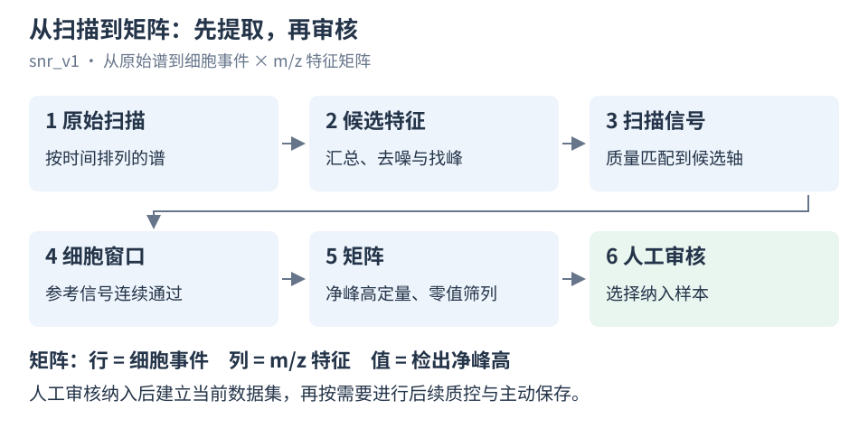
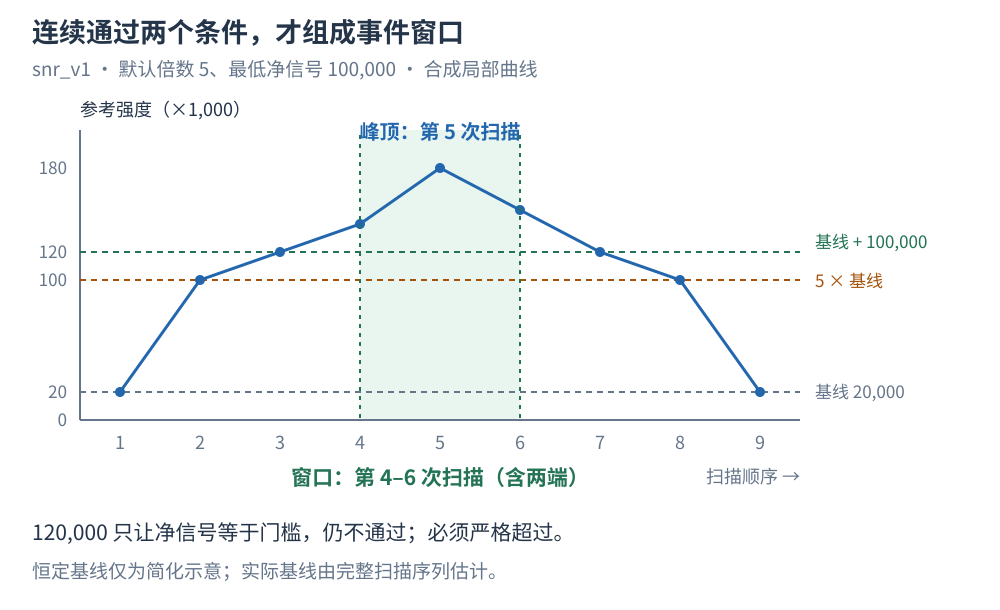
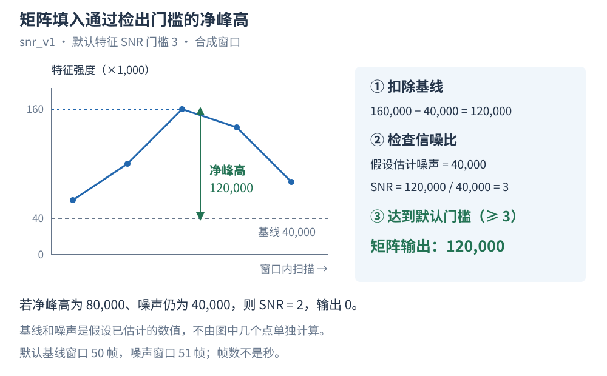

# 细胞提取

[文档导航](README.md)

从 mzML、mzXML 或 Thermo profile RAW 建立细胞 × 特征矩阵。使用空白和可信样本核对参考离子。审核建立当前数据集后，可以[注释特征](annotation.md)，也可以直接进入[统计分析](statistics.md)。

[添加文件](#添加文件与选择样本) · [预览与参数应用](#预览与应用参数) · [提取与审核](#提取停止与审核) · [SNR 图解](#从原始谱到细胞与特征矩阵) · [默认参数](#网页默认参数与适用范围) · [排错](#提取排错)

## 添加文件与选择样本

登录并[创建或打开项目](projects-and-data.md#登录与工作区)。在「添加原始文件」从管理员授权的目录选择样本，可跨目录勾选或直接输入服务器路径。切换存储根会清空文件选择。「重新定位」可为已登记样本指定新路径。

按样本填写名称、分组、个体与批次。名称须唯一且非空，样本信息 CSV 按 name 匹配。移出样本登记保留原始文件。需并入已有矩阵时，使用[合并已处理矩阵](projects-and-data.md#合并已处理矩阵)。

## 预览与应用参数

1. 在「预览」选择样本并打开文件。查看 TIC、EIC、合并谱或单扫描，确定参考离子、m/z 及提取范围。信号可切换为全宽。合谱展示范围可以拖选，正式提取范围单独应用。
2. 点击「预览细胞窗口」。它使用当前表单，显示候选事件。每个工作区最多运行一个预览。切换项目、样本、原始文件或参数后，按当前输入重新预览。侧栏可请求在安全阶段停止。
3. 选择「应用范围」，再点「应用参数」。项目默认保留既有样本例外，单样本应用仅修改例外。合并策略、合并容差和自动范围属于项目级设置。正式提取读取已应用配置，按「保存项目」将其写入项目。

单扫描索引从 0 开始，按当前 MS level 定位到最近扫描。色谱横轴用分钟展示，范围输入与数值下载沿用秒。合谱可选择求和或平均。显示下采样保留完整数值下载。Thermo reader 部署见[部署](deployment.md#thermo-raw-额外依赖)。

## 提取、停止与审核

逐样本参数有待应用的修改时，提取按钮旁会显示样本数。选择「应用并开始提取」可先应用这些修改，再启动新批次。

1. 在「提取」打开「处理准备」，查看预检和各样本生效参数。逐样本可复制整套或单个参数到其他草稿，批量应用前统一验证。点击「开始提取」会重新预检并冻结输入和参数。
2. 在批次表查看状态与信号，需要时下载预检 JSON 或完整日志。关闭网页后持久批次继续，停止请求会让当前样本安全结束后停止后续样本。阶段进度用于了解处理状态。重试只复用输入身份、参数和摘要一致的产物。
3. 勾选要纳入的成功样本，检查 QC，然后点击「建立当前数据集」。建立或替换当前矩阵后主动保存项目。

默认使用 `snr_v1`。服务器启用提取插件时，原始谱页的「提取方法」可分别选细胞识别和特征定量。
用草稿预览，确认后以「项目默认」应用，再开始批次。逐样本参数沿用项目选择的方法。批次显示冻结的方法版本和生效参数，
切换方法或版本后应开始新批次。[方法输入与产物](method-plugins.md#提取和特征注释)

所选批次结束且有成功样本时即可下载该批次**全部成功样本**的完整矩阵。审核勾选只决定纳入当前数据集的样本。标签编辑只影响 CSV。各下载的来源及列定义见[矩阵下载](projects-and-data.md#面向-metaboanalyst-的矩阵下载)。

提取页“比较两个处理批次”只选择两个已结束批次。默认只看差异参数，按稳定样本 ID 核对
输入路径和冻结文件身份；同名不能代替身份。结果显示成功/失败、细胞/特征数及逐样本 QC，
只有同一输入身份才提供细胞数 B−A。两批信号可并排查看并联动时间轴，缺失旧检测记录时明确提示，
不重新提取、不建立或替换当前数据。参数、样本结果与完整细胞 QC 可分别下载 CSV。
特征轴可能不同，数量增加不代表质量提高；不直接相减两个批次的矩阵。

## 从原始谱到细胞与特征矩阵

scMM 先汇总原始扫描谱，找到候选 m/z 特征，再用参考离子的信号识别细胞事件。
随后在每个事件窗口内扣基线、计算特征强度，筛去零值过多的特征。
你审核并纳入样本后，才建立用于后续质控和分析的当前矩阵。

下文以网页 **SNR 提取（`snr_v1`）** 为例，使用软件默认参数和合成信号。实际分析以项目已应用的参数为准。



*图 1：先提取，再审核。人工审核纳入后，才能对当前矩阵做后续质控。*

### 1. 最后会得到什么？

你会得到一张“细胞事件 × m/z 特征”矩阵：

- **每行**：一个检测到的细胞事件。
- **每列**：一个 m/z 特征，尚不代表已鉴定的化合物。
- **每个数值**：通过检出门槛的扣基线净峰高；未通过时为 0。

输入是按采集时间排列的 MS1 profile 谱，支持 mzML、mzXML 和 Thermo profile RAW。
一个事件窗口不一定对应一个完整细胞，因此矩阵行数首先是事件数，需要结合实验信息审核。

### 2. 开始前要选什么？

#### 选择并检查参考离子

参考离子帮助程序识别细胞经过时的信号变化。
先查看它的提取离子流（EIC），也就是该离子的强度随采集时间变化的曲线。

网页初始选中哺乳动物预设，参考 m/z 为 **760.5851**。
这只是软件起点，不能保证适合你的样本；实验者仍须明确选择并检查参考离子。

1. **看样本**：信号是否可检出，尖峰是否符合预期细胞事件？
2. **看空白**：同一离子是否也出现尖峰、高背景或周期性干扰？
3. **看全程和局部**：是否有漂移、饱和或长平台，实际匹配质量是否合理？

不要只因某个离子最强就选它。总离子流（TIC）的波动也不能代替参考离子检查。

#### 先认清本例使用的默认参数

| 参数 | 初始默认值 | 用在哪里 |
|---|---:|---|
| 参考质量容差 `reference_ppm_tol` | 10 ppm | 在候选轴上寻找参考离子 |
| 扫描质量容差 `ppm_tol` | 10 ppm | 将扫描谱峰匹配到候选特征 |
| 细胞信号阈值 `cell_snr` | 5 | 参考信号必须超过基线的 5 倍 |
| 最低净信号 `cell_min_signal` | 100,000 | 参考信号扣基线后还须超过此值 |
| 基线窗口 `baseline_filter_size` | 50 帧 | 沿扫描顺序估计滑动中位数基线 |
| 噪声窗口 `noise_window` | 51 帧 | 用附近背景残差估计噪声 |
| 特征信噪比 `feature_snr_threshold` | 3 | 特征净峰高／噪声达到 3 才检出 |
| 最大零值比例 `max_zero_frac` | 0.9 | 保留零值细胞比例不超过 90% 的特征 |

“帧”是扫描数，不是秒；实际时间跨度取决于扫描间隔。
这些是运算示例的起点，不是所有实验的最佳参数。

网页预览使用表单草稿，正式提取使用已应用到项目或样本的参数。
开始前请核对已应用值；完整默认值见[参数参考](#网页默认参数与适用范围)。

### 3. 怎样找到候选特征？

程序汇总扫描谱，估计基线并去噪，再找峰、计算代表 m/z，保留提取范围内的候选特征。
汇总谱用于寻找特征位置，它的强度不是单细胞强度。

汇总谱去噪的默认信噪比门槛为 **10**（`ms_peak_snr_threshold`）。
它与后面识别细胞用的 **5 倍基线**、定量特征用的 **SNR 3** 是三项独立判断。
分辨率、重采样密度和找峰选项也会影响候选结果。

| 特征策略 | 怎样建立候选轴 | 注意什么 |
|---|---|---|
| 共同特征 | 汇总所选输入，先建立共同候选轴，再逐样本提取 | 共同候选不代表每个样本都检出 |
| 独立特征 | 各样本分别找峰，再按合并策略和 ppm 容差对齐 | 并集可为未匹配特征补零；参考轴只保留其匹配范围 |

各次扫描的谱峰匹配到最近、且质量误差不超过 **10 ppm** 的目标列。
同一扫描有多个峰匹配一列时，常规默认取最大强度；显式选择 `sum` 才求和。

例如，目标 m/z 为 **760.5851** 时，10 ppm 约为 **±0.007606 m/z**。
实测 **760.5900** 的误差约为 **6.44 ppm**，在容差内；仍须满足“最近目标”的匹配规则。
参考离子也必须在自己的 10 ppm 容差内找到候选列，否则报错。

增大容差可能混合近邻峰。缩小图上的显示范围，不会改变矩阵的提取范围。
未进入候选轴，也不等于已经检测过却没有该分子。

### 4. 怎样识别细胞事件？

#### 每次扫描须同时满足两个条件

程序沿时间估计参考信号的基线，再逐扫描检查：

```text
参考信号／基线 > 5
参考信号 − 基线 > 100,000
```

这里的 **5 是基线倍数**，不是以噪声标准差计算的特征 SNR。
等于任一门槛都不通过；基线接近零时，程序使用正数下限避免除零。

假设某段基线为 **20,000**。第一个条件要求信号大于 **100,000**，第二个要求大于 **120,000**。
因此，这一段必须超过 **120,000** 才通过。基线变化时，判断仍逐扫描进行。

| 参考信号 | 信号／基线 | 扣基线净信号 | 是否通过 |
|---:|---:|---:|---|
| 100,000 | 5 | 80,000 | 否，两个条件均未通过 |
| 120,000 | 6 | 100,000 | 否，净信号只是等于门槛 |
| 140,000 | 7 | 120,000 | 是，两个条件同时通过 |
| 180,000 | 9 | 160,000 | 是，两个条件同时通过 |

#### 连续通过的扫描组成窗口



*图 2：合成示例，使用单参考和默认门槛。基线假设已由完整扫描序列估计；图中只展示局部。
点代表扫描，连线仅便于阅读。窗口包含第 4、5、6 次扫描。*

连续通过的扫描组成一个窗口，中间有扫描未通过就分开。
程序不会自动连接邻近窗口，也不会把窗口内每个局部峰拆成细胞。
长平台可能成为一个长窗口，背景尖峰也可能触发事件。

单参考时，窗口内**信号／基线比最大**的扫描是事件峰顶，其采集相对时间记为 `rt`，单位秒。
图中基线恒定，所以峰顶也恰好是原始信号最大处。基线变化时，两者可能不同；并列时取最早扫描。

#### 使用多个参考离子时

默认组合方式是 **任一通过**（`reference_mode=union`）：至少一个参考同时满足两个条件即可。
也可选择 **全部通过**（`intersection`）：所有参考都须在同一扫描通过。

多参考的事件峰顶取各匹配参考信号／基线比的平均得分最大处。
事件峰顶不要求与每个特征各自的峰顶重合。

### 5. 怎样得到矩阵中的强度？

#### 先扣基线，再检查特征 SNR

窗口确定后，每个特征分别扣除时间基线，取窗口内最大的非负净强度，称为**净峰高**。
程序用附近背景残差估计噪声，再检查这个净峰高是否足够明显。

```text
特征 SNR = 净峰高／峰高所在扫描的噪声
SNR >= 3：输出净峰高；否则输出 0
```

例如，某特征原始峰顶为 **160,000**，该处基线为 **40,000**，净峰高就是 **120,000**。
假设估计噪声为 **40,000**，则 SNR = 3，恰好达到默认门槛，矩阵填入 **120,000**。
若另一个特征净峰高为 **80,000**、噪声相同，则 SNR = 2，填入 **0**。



*图 3：合成窗口，基线和噪声是假设已估计的数值。它们不是由图中几个点单独算出的。
默认基线窗口为 50 帧，噪声窗口为 51 帧。*

各特征可以在窗口内的不同扫描达到最大净强度。
输出不是统一取参考峰顶那一帧，也不是峰面积。特征 SNR **等于 3 时检出**，与事件判定的严格大于不同。

背景仅取所有参考都未通过的扫描。局部背景不足时使用整体噪声估计，详见[完整判定](#完整判定)。
保留的 SNR 矩阵与强度矩阵逐项对应，包括强度被门槛置零的项。

#### 再筛去零值过多的特征

程序按样本计算每个特征的零值细胞比例，默认保留比例 **不超过 90%** 的列。
例如，10 个已提取事件中有 9 个零值，该列保留；10 个全为零则移除。

这是提取阶段的筛选，发生在人工审核之前。
**零值不等于分子不存在**：它可能来自未匹配或未通过定量门槛。

人工审核纳入后，网页质控先筛细胞，再按保留细胞中的正值检出比例筛特征。
此时分母是本次保留的细胞数，不能直接沿用提取时的比例。
归一化、插补和手动裁剪不重判原始窗口；先插补再筛选会影响检出比例。

### 6. 提取后怎样检查？

1. **看参考曲线**：对照样本与空白，检查基线和窗口，并核对已应用参数。
2. **查异常窗口**：抽查弱信号、相邻峰、长平台和背景尖峰，核对峰顶时间与窗口边界。
3. **核对数量与定量**：比较各样本的事件数、特征数和零值情况，抽查质量匹配、净峰高与噪声。
4. **审核纳入**：在“提取审核”中选择纳入样本，再建立当前矩阵。自动提取完成不等于人工审核通过。
5. **记录并保存**：记录后续每次筛选前后的数量，以及归一化、插补等处理顺序，主动保存项目。

一个窗口不保证只有一个完整细胞，精确质量候选也不等于化合物鉴定。
前者需要实验信息支持，后者还需标准品、MS/MS 等证据。
原始文件只被引用，保存项目不能代替原始谱备份。

常规输出不保证保存每个已移除候选的逐项解释。
若需逐峰复核，应保留原始输入、实际参数和诊断数据，必要时离线复算。

### 查阅细节

#### 完整判定

以下补充公式与边界，仍只说明 `snr_v1`。

**汇总谱去噪。** 沿 m/z 估计局部分位数基线，扣除后得到净信号。
局部噪声为 `max(1.4826 × MAD, 1e-12)`；MAD 是残差相对局部中位数的绝对偏差中位数。
净信号／噪声低于默认门槛 10 的点置零，等于时保留；默认不保留负净信号。

**质量匹配。** 扫描对齐以目标质量为分母；参考匹配以指定参考 m/z 为分母。
两项容差分别设置，初始默认均为 10 ppm，等于容差允许匹配：

```text
ppm_error = |实测 m/z − 目标 m/z| / 目标 m/z × 1,000,000
匹配条件：ppm_error <= 对应容差
```

**事件窗口。** R(t) 为参考信号，B(t) 为时间基线。
eps 是计算浮点类型的正数精度下限，用于避免除零：

```text
R(t) / max(B(t), eps) > cell_snr
cell_min_signal > 0 时，还须 R(t) − B(t) > cell_min_signal
cell_min_signal = 0 时关闭附加净信号条件
```

每个参考先独立判定，再按 `union` 或 `intersection` 组合。
峰顶取去重后的匹配参考列比值的平均得分首个最大位置。
连续窗口的首末扫描都参与定量。

**特征定量。** Xj(t) 为特征 j 的原始信号，Bj(t) 为其时间基线：

```text
D(t) = Xj(t) − Bj(t)
t* = 窗口内 D(t) 首个最大位置
H = max(D(t*), 0)
SNR = H / max(noise(t*), eps)
若 SNR >= feature_snr_threshold，输出 H；否则输出 0
```

**噪声估计。** 背景仅含所有参考都未通过的扫描；选择 `intersection` 时，不一定包含全部窗口外扫描。
局部噪声取背景残差的标准差：先算平方均值减均值平方，将负方差截为零，再开方。
局部背景少于两个点，或所得噪声不高于 eps 时，使用整体估计。

整体背景多于一个点时，用背景残差的样本标准差（`ddof=1`）。
否则用全部残差的总体标准差；整体噪声与 SNR 分母均设 eps 下限。

**特征筛选。** 提取阶段按输出强度是否为零统计，保留零值比例 `<= max_zero_frac` 的列。
没有事件时，各列零值比例按 1 处理，因此默认 0.9 下不保留列。
网页后续质控按当前值是否大于零统计，细胞与特征筛选均在等于门槛时保留。

#### 时间与扫描字段

| 字段／概念 | 如何确定 | 不能据此推断 |
|---|---|---|
| `rt` | 事件峰顶对应扫描的保留／采集相对时间，单位秒 | 刺激后的实验时间或生物学阶段 |
| `cell_apex_scan` | 峰顶扫描的源索引 | 行号或跨文件通用索引 |
| `cell_start_scan`、`cell_stop_scan` | 连续事件窗口两端源扫描索引，含端点 | 额外外扩的背景区间 |
| `cell_start_rt`、`cell_stop_rt` | 窗口两端扫描的时间，单位秒 | 每个特征各自达到峰顶的时间 |
| `cell_scan_count` | 进入窗口的已选扫描数，含两端 | 原文件所有 MS 层扫描数 |
| `acquisition_time`（存在时） | 文件采集起始时间加峰顶 `rt` | 自动校正过的跨仪器实验时钟 |
| `time` | 装载入口建立的归一化时间，提取时继承峰顶行 | 默认的秒、分钟或真实实验时间 |
| 实验时间 | 用户依据实验记录提供 | 程序能从信号自动确定 |
| 伪时间 | 分析方法在指定输入上估计 | 直接测得的真实采集时间 |

源扫描索引可能因只选 MS1 而不连续，应结合源文件身份使用。
原始文件改变后不能复用旧扫描索引。旧结果若缺少窗口字段，只能报告已有证据，不能补称窗口已验证。

单文件原始装载的 `time` 是扫描 `rt` 除以该文件被装载扫描的最大 `rt`，之后提取继承峰顶值；
旧目录汇总入口可根据文件时间戳和全目录时间跨度归一化。不能跨入口假设归一化时间等同。


#### 复现记录要求

| 内容 | 至少记录什么 |
|---|---|
| 输入与方法 | 原始文件身份、格式、采集方法、时间依据、软件及算法版本 |
| 特征轴与匹配 | 提取范围、分辨率、重采样密度、汇总谱去噪及找峰选项、共同／独立策略、ppm 容差、扫描聚合和样本合并方式 |
| 事件与定量 | 实际匹配参考及选择依据、参考曲线和窗口、时间基线选项、倍数及净信号门槛、多参考组合、强度定义、噪声与特征阈值、零值比例门槛 |
| 人工审核与处理 | 逐样本提取数量、纳入／排除范围及理由、每次筛选前后数量、归一化／插补／去同位素等的顺序与参数、保存的矩阵及起点 |
| 分析与图 | 强度层、分组与生物重复单位、作图子集、聚合权重、标准分、聚类、色阶和随机 seed |

细胞数不等于生物重复数；统计仍须考虑样本或个体来源及处理泄漏。
图中的分组、均值、标准分、聚类和色阶属于展示，不能成为新的事件识别或鉴定证据。
网页注释和同位素标记也不等于已经执行 内部 Python 的删峰式去同位素。

矩阵 CSV 的 Label 来源随下载入口而定，见[矩阵下载](projects-and-data.md#面向-metaboanalyst-的矩阵下载)。用于复现时同时归档项目、细胞元数据与原始谱。
本文及三张图说明实现，不代表新增真实实验验证。

完整默认值见[网页参数](#网页默认参数与适用范围)，
保存与导出见[数据与输出](projects-and-data.md)，统计解释见[分析](statistics.md)。

## 网页默认参数与适用范围

| 参数 | 新项目默认值 | 用途 |
|---|---:|---|
| `mz_min` / `mz_max` | 100 / 1000 | 读取采集范围前的初始 m/z 窗 |
| `resolution` | 35,000 | m/z 200 处分辨率的软件初始值，按仪器采集设置核对 |
| `resample_points_per_fwhm` | 5 | 每个半高峰宽的插值采样密度 |
| `ms_peak_snr_threshold` | 10 | 合并谱保留候选峰的阈值 |
| `reference_mode` | union | 多参考离子各自满足细胞判定后取并集，可改为交集 |

细胞与特征定量的常用阈值见[SNR 图解](#2-开始前要选什么)。网页「参数参考」列出当前项目设置及新项目默认值。

网页首次创建项目的参考离子来自全局细胞类型预设：哺乳动物 `760.5851`（初始默认）、藻类 `734.5929`、细菌 `690.5069`。
可修改、新增预设并显式保存；项目保留自己的参数，后续修改全局预设不会覆盖旧项目。
全局预设默认写入 `~/data/results/.scmm-preferences.json`，可通过 `SCMM_PREFERENCES` 指定服务独立配置文件。

网页 `n_jobs` 默认取进程可用逻辑 CPU 数的四分之三，向下取整且至少为 1。
首次读取原始文件时 m/z 上下限就近取整到 50 的倍数，恰好位于中点时向上取整；例如 126–974 得到 150–950。
若两端就近取整后重合，则下限向下、上限向上取到 50 的倍数，例如 140–160 得到 100–200，保证范围有效。
就近取整可能缩窄测量范围，正式应用前仍须核对范围与参考离子；共同特征采用各文件范围的并集，独立模式使用各文件范围。

「预览」的“提取时间范围”和“原始帧范围”作用于正式合谱、特征定量及细胞识别。可填写端点，打开文件后也可拖动范围滑块；选择样本作用域后应用即可逐文件裁剪。RT 使用秒，原始帧从 0 开始，范围包含端点；同时填写两种范围时取交集。原始图的缩放和显示 RT 范围仍只影响展示，不会替代提取参数。修改范围后重新预览、提取并审核纳入；已建立的当前矩阵不会自动重算。

“读取采集信息”检查 XML 或 RAW 前 32 个 MS1 扫描可用的采集质量窗和分辨率记录。RAW 使用独立元数据读取模式；未记录的字段显示未读取到，读取失败明确报错。分辨率参考质量不明时不自动填入 m/z 200 处的参数。

`cell_snr` 是参考信号/基线比值；`feature_snr_threshold` 是净峰顶强度与背景噪声标准差的比值，二者含义不同。界面展开“参数含义、单位与算法差异”可查看全部解释。
手动选择“灵敏/严格”等预设会重新设置相应阈值，实际生效值以控件和任务清单为准。

缺少 `cell_min_signal` 的历史项目会拒绝打开。使用当前项目格式重新提取。已保存的显式阈值继续用于项目或样本。

## 原始信号独立诊断

在「预览」打开原始样本，展开“原始信号诊断（可选）”，明确选择 TIC/EIC 及基线；EIC 另填离子列表，中位基线另填奇数扫描窗口。
可独立指定 MS 级别和 RT 范围，检查重构参数后点击“运行独立诊断”。图对照原信号/基线/重构、扣基线信号/秩一近似及残差/估计噪声。
“下载作图数据”保留完整诊断与噪声表，不受 200 行表格预览影响；主动保存项目保留最近成功诊断的参数和只读图，重新计算需原始输入。
切换信号、参数或样本清除旧显示；它不会应用提取参数、识别细胞或建立当前矩阵。解释与限制见下方的计算定义。

诊断成功后项目显示待保存；保存的是最近成功运行的参数和图，未重新运行的表单修改仅为页面草稿，不替换已保存诊断。

原始页的“独立原始信号诊断”仅检查原始扫描，明确选择 TIC 或指定 1–8 个离子的 EIC，以及零基线或逐通道扫描中位基线。
EIC 按各参考离子的 ppm 窗口累加强度，窗口重叠时通道可以共享峰，不当作独立特征。
按原扫描顺序计算，RT 仅用于范围筛选和显示；不插值成等时间序列。中位窗口由用户填写奇数扫描数，边界使用 reflect。

设原始信号为 S、所选基线为 B，现有 `peak_recon` 计算非负峰 C 和逐通道迭代噪声估计。
重构为 B+C，残差为 S-B-C；导出另列残差总体标准差（ddof=0），与算法估计的 sigma 分别报告。
这两者都不是当前提取 SNR、空白对照或置信区间；没有自动识别细胞，也不修改项目提取参数或矩阵。
`r1_decomposition` 对 S-B 运行既有全一向量初始化的交替秩一近似，输出 a@b.T 及对应残差；
它不是 SVD 或全局最优/收敛证书，初始化可在抵消输入上退化，单通道结果不提供多通道结构证据。

每次最多 20000 个扫描、8 个通道；超限要求缩小 RT，不能静默裁剪。输入须有限；单扫描、空选择、过大强度拒绝。
迭代在冻结的有限数值上执行，不持工作区锁；返回前复核当前工作区修订、样本和原始文件身份，变化时拒绝旧结果。成功时仅提交项目视图并递增工作区修订、标记待保存；科学矩阵与提取参数保持原值。
图的完整数值附件保留扫描索引/RT/通道、信号/基线/重构/两类残差和噪声，并记录输入身份及全部生效参数。
最近成功诊断的参数和只读图随主动保存项目保留；原始文件不复制，重新计算仍须重新打开原始输入。

#### 诊断参数

诊断不继承提取参考离子或基线，须显式选择 TIC/EIC 和 zero/median 基线；EIC 须填写不同的正数参考 m/z（最多 8），
ppm 默认 10，MS 级别默认 1，RT 秒范围留空为全部选中级别扫描。中位窗口无自动默认，须填写 3–1001 的奇数且不超过选中扫描数；零基线不使用窗口。
独立重构参数沿用现有工具默认：`lam=0.5`、`tau=2`（非负）、`sigma_min=0.001`（正数，强度单位）、
`max_iter=50`（1–1000）；工具内部相对变化容差固定 `1e-4`。
秩一 `rank_tol=1e-6`（正数，向量变化绝对容差）、`rank_max_iter=100`（1–1000）。
固定 float64、单线程，独立于正式提取资源配置；噪声/残差与算法限制见[独立诊断定义](statistics.md)。

## 提取排错

提取已经结束但分析页无法计算时，先在「提取」确认有成功样本，勾选纳入范围并建立当前数据集。批次状态与日志可用于核对当前阶段。

### 推荐的调参顺序

一次只调整一类参数，并记录细胞数、特征数、零值比例和代表性图形：

1. 确认原始文件可读、MS level 和质量范围正确；Thermo profile RAW 先检查外部 reader。
2. 确认 `REF_MZ` 附近确实有稳定峰。
3. 调整 `CELL_SNR`，先得到可信的细胞事件。
4. 调整 `MS_PEAK_SNR`、`PEAK_SNR` 和 `MAX_ZERO_FRAC`，控制特征质量。
5. 检查 ppm 误差后调整 `PPM_TOL`。
6. 再评估去同位素、异常值、填补和归一化。
7. 最后在[统计分析](statistics.md)中核对降维、聚类和时间分析参数。

如果同时降低所有 SNR、放宽 ppm 并提高零值容忍度，虽然会得到更多特征，但无法判断新增信号
来自哪个选择，也更容易把噪声当作生物学变化。

#### 输入目录没有发现原始文件

- `load_from_filelist()`/`load_from_directory()` 与 CLI 支持 `.mzML`、`.mzXML`、Thermo profile `.raw`，扩展名大小写均可。
- 旧 `batch_process()` 助手仍只扫描 XML；读取 RAW 时使用上述入口，并核对 [外部依赖](deployment.md#thermo-raw-额外依赖)。
- `load_from_filelist()` 和 `batch_process()` 只扫描目录直接子文件，不递归。
- 检查 `INPUT_PATH` 是否误指向上一级目录。
- 已处理目录应包含 `.meta`；否则 `INPUT_KIND="auto"` 会把它当作原始目录。

#### `No spectra found`

常见原因是文件为空、目标 MS level 不存在，或所有扫描都落在底层汇总函数默认 m/z 范围之外。
XML 用 PyOpenMS、RAW 用 reader 检查谱数和 MS level；高层加载可设置 `mz_range`，CLI 可设置
`--mz-min`/`--mz-max`。网页显示范围不改变提取范围，参数解释见 [参数参考](internal-reference.md#原始谱与细胞检测)。

### 细胞事件识别

#### 没有识别到细胞

按顺序检查：

1. `REF_MZ` 是否写错、极性是否匹配。
2. 最近的实际特征离参考 m/z 有多远。
3. 参考离子的 EIC 是否存在细胞状尖峰。
4. `CELL_SNR` 是否过高。
5. `BASELINE_FILTER_SIZE` 是否过小，以至于基线跟随了细胞峰。
6. 合并谱 `MS_PEAK_SNR` 是否先把参考峰删除。

可以从 `CELL_SNR=3`、`MS_PEAK_SNR=5` 做诊断，但正式参数应结合空白假阳性恢复到更保守的值。

#### 识别到过多细胞或长连续区间

- 增大 `CELL_SNR`。
- 检查参考离子是否在背景/溶剂中持续存在。
- 减小过宽的基线窗口，确认局部漂移得到合理估计。
- 检查离子源是否存在持续喷雾团块或饱和。
- 使用稳定性质控图观察事件是否集中在异常采集阶段。

#### 细胞数合理，但特征太少

- 降低 `PEAK_SNR`，例如从 3 降到 2。
- 降低 `MS_PEAK_SNR`，避免公共特征轴过早丢失弱峰。
- 提高 `MAX_ZERO_FRAC`，允许更稀有的特征。
- 检查 `PPM_TOL` 是否小于实际质量误差。

每次只修改一个参数，并使用空白或随机区间估计新增特征中的噪声比例。

#### 特征过多、矩阵极度稀疏

- 增大 `MS_PEAK_SNR` 或给 `prominence_ratio` 设置小的正值。
- 增大 `PEAK_SNR`。
- 降低 `MAX_ZERO_FRAC`，例如从 0.90 调到 0.80。
- 检查分辨率是否设置得远高于真实仪器分辨率。
- 检查 ppm 容差过大是否把噪声错误投影到候选峰。

### 性能和内存

内存压力通常来自“扫描数 × 公共 m/z 网格”和“细胞数 × 特征数”。处理建议：

- 先用单文件验证，不要直接并行整个批次。
- 在「计算资源」降低并行数。内存吃紧时先用 1 个作业验证。
- 使用与仪器一致的 `RESOLUTION_200`，不要人为设得过高。
- 适当降低 `RESAMPLE_POINTS_PER_FWHM`，但应检查峰形和对齐。
- 使用更严格的合并谱 SNR 和稀疏特征过滤。
- 分批处理可以定位资源瓶颈。评估质量轴与样本映射后，可[合并已处理矩阵](projects-and-data.md#合并已处理矩阵)。
