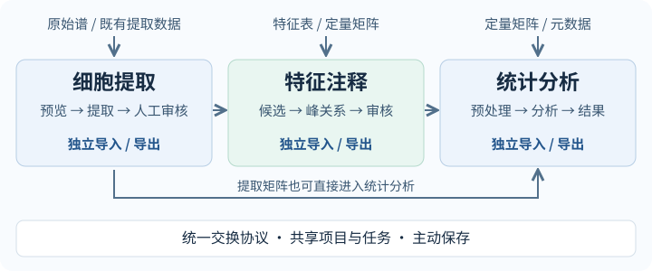

# 项目与数据

[文档导航](README.md)

在项目首页创建项目或打开已保存项目，再按输入数据选择板块。三个板块共用项目和主动保存。



| 手上的数据 | 从哪里开始 |
|---|---|
| mzML、mzXML 或 Thermo profile RAW | [细胞提取](extraction.md) |
| 只有 m/z 特征表，或已有待注释矩阵 | [特征注释](annotation.md) |
| 已有细胞或样本定量矩阵 | [统计分析](statistics.md) |

[打开与保存](#保存和离开) · [交换格式](#选择交换格式) · [矩阵下载](#面向-metaboanalyst-的矩阵下载) · [图表与报告](#图表作图数据和报告) · [快照与缓存](#快照与缓存管理)

## 登录与工作区

先用管理员创建的账号登录。首次登录或重置后须设置自己的密码。团队共享项目与授权原始文件，各标签页的未保存工作状态按账号和工作区隔离。登录与资源配置见[部署](deployment.md#服务器初始化与账号)。

切换步骤保留本页表单和图形，切页本身不触发计算或保存。刷新浏览器、关闭标签页或切换项目之前，先保存需要保留的内容。修订冲突可点击「刷新状态」读取当前工作区。浏览器刷新后应重新打开已保存项目，持久提取批次可继续核对。

## 选择交换格式

| 所需内容 | 选择 |
|---|---|
| 之后在同一服务器继续完整工作 | 点击「保存项目」，下次打开完整项目 |
| 在板块或项目间移交来源、起点、分支和审阅记录 | 导出完整 scMM 交换包。导入替换目标项目的全部数据集合，保留目标项目身份 |
| 交付当前活动矩阵及其同轴元数据和层 | 导出独立 H5AD。重新导入时，该矩阵成为新的预处理起点 |
| 交付当前矩阵、观测与特征元数据 | 导出开放表格 ZIP |
| 仅移交用于注释的峰 | 导出含稳定特征 ID 与 m/z 的特征 CSV |

各板块使用当前数据或导入文件。定量 CSV 可选择细胞或普通样本为观测单位，指定矩阵方向并预览。配套元数据按稳定 ID 匹配。仅特征表可独立注释。详细字段和校验见[模块交换协议](internal-reference.md#模块交换协议-v1)。

## 保存和离开

项目默认保存在 `~/data/results`，可用 `--project-root` 指定已存在的独立目录；原始文件只引用，不复制。
`--output` 不改变项目根目录。
以页顶“已保存 / 已应用未保存”及单列的未应用草稿为准。按钮直接执行，不使用确认复选框或二次确认弹窗；
新建、打开、关闭项目会放弃未保存修改，浏览器关闭或刷新也不弹出保存确认。需保留时先主动保存。
未应用的参数表单不属于已保存参数，不自动保存项目；只有管理员显式审阅启用的持续保留策略才定期清理无引用旧产物。

新建项目、提取批次、保存快照和 H5AD 默认名称包含北京时间，快照及 H5AD 带修订号；
H5AD 还包含项目名和已填写的样本批次标签。已有目录保持原路径，具体规则见[保存布局](internal-reference.md#当前网页项目保存)。
结果与保存页可单独导出当前数据 H5AD，默认写入当前项目的 `exports/`；保存前显示完整目标路径，文件名可修改，拒绝覆盖。
“下载上次保存的 H5AD”另有文件名输入框，下载内容仍为上次项目快照，不包含未保存修改。

项目列表每行提供“移入回收站”；当前打开的项目须先保存并关闭。提取批次在“提取”的批次选择处管理，
预览缓存位于“预览”，历史快照在“结果与保存”的保存记录，独立导出在服务器导出区域管理。
各入口先显示路径、文件数和占用的行内计划，再直接执行，不使用二次确认弹窗。
项目内管理允许清理经核实无引用的旧产物；当前清单、未保存数据来源、其他打开的工作区及活动任务仍受保护。
项目首页保留统一回收站、高级保留策略与外部结果管理。移动不释放空间，永久清空后才释放。
保存区的“什么操作会写入哪些文件？”说明新建、预览、提取、审核、分析、保存与下载的写入时机；
完整文件定义见[操作与磁盘写入](internal-reference.md#操作与磁盘写入时机)。
项目列表区分尚未保存数据、已保存数据及快照不可读取，并显示已保存矩阵的细胞数和特征数。
打开含数据的完整项目会自动恢复最后主动保存的矩阵和预处理起点，并进入预处理页，无需再次导入。
最后修改时间表示最近一次成功保存项目，不代表一定保存了矩阵。切换前先主动保存需要保留的修改。
“导入 H5AD 数据”用于 独立 H5AD 文件：手动选择文件，点击“检查所选结果”，核对维度、样本、分组和数据层，
再点击“导入并替换当前数据”。这会建立新的预处理起点，不恢复原项目全部内容；应先保存需要保留的修改。
浏览器只提示最近记录的可用矩阵，不自动选中，文件时间不能代替版本依据；默认收起内部产物，可展开查看。
完整恢复请使用“打开完整项目”，避免把 `baseline.h5ad` 或逐样本提取文件误当作最终结果。
首页加载和未选择项目的刷新不会启动删除保护扫描；选择内容后的引用/任务检查可能随共享目录大小耗时。
系统重新检查内容身份、项目引用和未结束任务；原始谱、符号链接、存储根目录及其他环境的项目内容不能删除。
回收区支持恢复到原路径，不覆盖同名内容；父目录已删除时先恢复所属项目。
回收区由资源配置指定；已有部署可继续共用通用目录约定 `~/data/results/recycle`，不自动迁移旧条目。
移入回收区不释放磁盘空间；仅管理员可“清空回收区”，立即永久删除共享回收区内全部条目，不二次确认，无法恢复。
系统检查回收路径、符号链接、活动任务和引用；失败会报告未清理条目。原始谱引用不会移动原文件。

## 合并已处理矩阵

在“添加原始文件”展开“合并已处理矩阵”，选择 2～8 个输入：当前数据（最多一次）或授权结果目录中的独立 H5AD 文件。独立结果导入会替换数据；本入口才执行多个结果的匹配合并，不调用仅支持旧目录的 `concat()` 读取 H5AD。

逐输入明确选择 m/z 列（或明确使用数值特征 ID），选择样本列或整份输入作为一个样本，检查当前与起点的维度。为每个来源样本填写目标样本名；同名表示主动合成同一样本，也可生成带输入序号的独立名称。group/subject/batch 留空保留原细胞值，填写则覆盖对应来源样本。需要共同分析的其他细胞列须逐项声明为共同列；原列仍按来源保留，系统不推断单位或实验含义。

明确参考输入及 union/ref，核对 ppm 容差，点击预览。页面分别显示当前矩阵和完整恢复起点的匹配、未匹配及歧义；表格最多显示 200 行，完整 ZIP 包含全部行。默认歧义阻止应用；明确选择沿用原贪心规则后才允许应用。调整参数须重新预览，预览有效期 5 分钟，源文件或工作区变化须重新预览。

“合并并替换当前数据和起点”直接应用候选，不自动保存。当前 ref 只保留参考特征；完整恢复起点始终 union 合并各输入的实际起点，故“恢复到预处理起点”可能恢复更多细胞和特征。独立文件自身就是其起点，不能据文件中的层或 raw 推断原项目完整起点。旧分析、图表和报告清除后重新计算，项目仍须主动保存。合并后可下载历史合并溯源；它描述当时匹配，并不代表后续变换后的当前分析。

### 已处理矩阵合并参数

网页需显式选择参考输入、union/ref、各输入质量来源、样本分组及目标样本名；质量来源可以是指定 var 列或明确的数值 var ID。ppm_tol 初值 5，沿用已有 alignwith/concat 默认参考 ppm，允许有限的 0～1000000；这不是实验容差建议。歧义默认 reject，用户可明确选择 legacy 沿用原一对一贪心规则。common_observations 初始为空，最多 100 个显式共同细胞字段，不推断单位或缩放。group/subject/batch 空值保留原值，非空覆盖，目标样本名相同表示主动合并。

同步工程门限：2～8 个输入、最多 2000 个来源样本映射；每个输入和输出最多 2 万细胞、1 万特征、500 万 X 值，输入当前/完整起点及层/raw/归档元数据累计最多 2000 万存储值；输出也检查同样的总值限制。单文件最多 256 MiB，所选文件累计最多 512 MiB，H5AD 解码前核对存储值，候选匹配比较最多 20 万。超限明确拒绝，不静默截断数据。预览列表最多显示 200 行，完整 ZIP 不截断；预览凭据有效期 300 秒并绑定用户工作区、修订和输入身份。合并在同步请求内完成。

### 已处理矩阵的质量匹配

网页合并沿用 `CyESIData.alignwith()` 的参考 ppm 定义与逐输入贪心规则：参考 m/z 升序处理，每个目标选择容差内最近且未使用的来源特征，一对一匹配；参考输入先处理，其他输入按所选顺序处理。union 新增特征可成为后续输入的目标，ref 丢弃未匹配的当前特征。输入顺序和参考集会影响结果，不能解释为全局最优分配；完整溯源记录顺序、容差、候选数与实际匹配。

m/z 必须有限、正且唯一；多候选/竞争目标显式标记歧义，默认拒绝，用户选择 legacy 才按原规则执行。X 为 float64，缺少的合并特征补 0；原层和 raw 的缺失含义不同，见[数据格式](internal-reference.md#合并矩阵与完整起点)。不合并或拟合原降维、图、聚类或模型；保留来源注释而不静默择一覆盖。合并不做批次校正、不统一强度定义、不替代上游共同特征提取，也不把细胞或同名样本视为独立生物重复。共同时间列及单位须由用户确认后声明。

## 面向 MetaboAnalyst 的矩阵下载

在“提取”选择已停止的处理批次，即可下载该批次全部成功样本的完整提取矩阵，无需先审核建立数据集；后续预处理不会裁剪或改变此下载。
下载来源固定为所选批次的成功样本产物，使用该批次冻结的特征合并规则，不随当前分析分支或审核勾选切换；运行中的批次、无成功样本或产物损坏时不可下载。
“预处理与 QC”可下载当前活动分支已应用全部处理步骤后的完整 X，不含未应用的预览或 PCA/UMAP 坐标。
这两个入口采用 `Sample,Label,特征…`：Sample 为唯一细胞 ID，Label 默认使用样本名；展开“CSV 标签设置”可逐样本改名或把多个样本设为同一标签。
改名仅用于该入口 CSV，不修改样本名称、group 或分析结果；设置为当前页面会话草稿，不随正式项目保存。
下载验证工作区修订，保留数值精度、细胞和特征顺序。负值不会自动平移，MetaboAnalyst 对输入值的适用要求需按目标模块检查。


既有结果页“当前矩阵 CSV”和注释模块“筛选矩阵 CSV”共用格式：细胞为行、特征为列，首列 `Sample` 为唯一细胞标识，
第二列 `Label` 来自细胞元数据 `group`，其余列仅为稳定特征 ID 对应的数值。此结构为 `lcms_table.csv` 示例的转置方向，
符合[MetaboAnalyst 单因素样本在行格式](https://www.metaboanalyst.ca/docs/Format.xhtml)。
缺失／空白分组或重复标识报错，不用样本名猜测组别。当前版本固定使用 `group`，不支持导出时改选分组字段。
导出保留矩阵顺序、零值、负值和完整浮点精度，不自动插补或归一化；是否适合目标模块仍需按实际强度层判断。
筛选矩阵只裁选特征，不按页面分页截断细胞。精确 m/z 与候选注释通过稳定特征 ID 对应，不能把候选物质名称当作唯一列名。
这不是多因素／时间序列元数据表，也不将单细胞当作独立生物重复。

旧目录内部 `data.csv` 与 `peak_meta.csv` 保持分离布局，供内部 worker 保存／重载；该内部文件不是上述网页矩阵下载契约。
H5AD、嵌入坐标、QC、统计结果及作图 ZIP 内源表各保留原有用途和字段，不额外插入 `Label`。
事件、时间和保留峰的完整方法见[细胞事件与特征峰确认流程](extraction.md#从原始谱到细胞与特征矩阵)。

## 网页帮助与按钮

参数、主要表头和辅助路径旁的圆形 `?` 提供说明，支持悬停、键盘聚焦与点击，Esc 可关闭。
参数使用中文显示名，悬停可查看英文参数键、单位和说明。预处理的归一化设置
提供当前选项说明和全部方法列表；选择方法不执行计算，仍需点击检查影响或应用。
正文、表单和表格以 13px 为基准，辅助说明 12px，页面标题 22px，分区标题以 16px 为基准。按钮按功能区分，计算/应用蓝色、
保存/导出绿色、预览/检查紫色、恢复/停止橙色、删除红色，导航与展开使用中性色。

## 图表、作图数据和报告

- 每张图的“图例位置”可独立选择图右侧、图内四角或隐藏；连续颜色条也随位置调整。
- 网页分类图例默认按名称自然升序，英文忽略大小写，数字按数值比较（A2 在 A10 前）。展开“调整图例顺序”可拖动或上下移动，并可恢复默认；颜色与类别保持对应，连续色条保持数值顺序。
  顺序按图记录，主动保存项目后重开恢复；SVG/PNG/PDF 与作图数据保留当前图例顺序，分类饼图也支持调整。内部 Python 绘图沿用其现有设置。
- 图下常用操作为导出范围、预览、SVG/PDF/PNG 和完整作图数据下载；“导出设置”集中论文规格、
  物理尺寸、字号、DPI、图例位置与顺序、点不透明度、文件名和自定义标题/轴标签，按需展开。
  设置随项目保存，重新计算后继续使用。默认导出“当前视图”，也可选择“完整范围”。

Plotly 图提供 Nature（89/183 mm）、Cell（85/114/174 mm）及自定义宽度规格。
Cell 尺寸依据[Cell 图形规范](https://www.cell.com/information-for-authors/figure-guidelines)，预设采用 7 pt 字号、0.7 pt 线宽，
默认不显示图内主标题，主标题与图注另附；推荐高度不超过 200 mm。彩色／灰度、黑白、线图分别提供 300、500、1000 DPI 起点。
SVG/PDF 保留二维矢量，PNG 按物理尺寸生成并写入 DPI；三维或热图可能包含栅格内容，仍须核对其有效分辨率。
Cell PDF 只使用服务器实际安装的 Arial 并嵌入；未找到字体或字符不被覆盖时明确提示，不以其他字体冒充。
SVG 声明字体但不嵌入，PNG 依赖浏览器字体；请在装有 Arial 的排版环境核对最终文件。通用 PDF 保留原有可嵌入替代字体支持。
Cell 单图导出超过 20 MB 时提示调整；该预设不保证整张多面板图已满足所有投稿要求，也不提供 TIFF。
页面及导出图的系统自动标题、坐标、图例、颜色条、子图注释和悬停字段统一英文；
样本名、分组名、特征名称、结果键和自定义标题等用户输入保留原文。图形不再提供系统标签的语言切换。
原始谱与分析共用导出规则：“当前视图”固定点击时的缩放/平移范围、三维视角及图例显隐；
“完整范围”使用本次已生成图形的完整范围，不重新读取整个原始文件。原始图的“选择合谱范围”
只设置后续合谱 RT 范围，须切换合并谱并更新图形，不等于缩放或裁剪当前图。
缩放、复位后再缩放及多子图沿相同规则导出；作图数据与完整源表不因屏幕缩放裁剪。
图表工具栏“下载论文 SVG”和图下下载按钮使用同一导出路径；“预览导出效果”查看按论文设置生成的 SVG。
点不透明度默认 1，可显式调整且同时作用页面和导出；不会对矩阵数值或整图做亮度增强。热图色阶独立设置并随作图数据记录。
导出设置与网页可读字号分别控制，期刊最终要求仍以官方指南为准。

「结果与保存」首先提供“保存项目 · 继续完整工作”，随后区分“下载到本机”和“导出到服务器 · 独立 H5AD”，大屏并列排列。下载项使用中文业务名称；没有嵌入、没有快照或分析尚未计算/已失效时说明原因，保留后端下载身份检查。
项目快照路径、文件引用及 H5AD 保留说明按需展开。主动保存完整快照；下载当前矩阵、嵌入、QC、处理记录和有效分析报告，
或单独导出当前 H5AD（拒绝覆盖）。上次快照 H5AD 不包含未保存修改。项目图形可重载查看并下载 JSON，
每张图支持自定义文件名及 SVG/PNG 导出，图例位置独立保存。

## AI 分析助手

在“我的账号”填写个人 `Base URL`（例如 `https://api.openai.com/v1`）、`Model` 和 `API Key`，
点击“保存 API 配置”；每次保存或替换都须重新输入 Key，避免修改地址时误用旧 Key。
服务器加密保存个人配置，下次登录可继续使用；网页只显示“已配置”，支持直接删除。
“测试连接”使用**已保存配置**发送最小问题，不附带实验上下文，可能产生 API 费用。
服务器启用及内网地址放行见[个人 AI 配置](deployment.md#个人-ai-配置)。

工作台右下角“AI 分析助手”可展开或收起。支持输入问题、三个快捷问题、流式回答、
停止生成和清空对话。对话和输入草稿按用户及工作区/项目加密保存在服务端；刷新可恢复，切换项目分别保留，退出登录清除当前页面显示。
聊天不进入团队共享项目快照。流式回答中断后标明未完成，不自动重发。当前模型及“本次发送的上下文”显示本轮实际使用值。

助手只提供步骤解释、结果含义与下一步建议，不能修改参数、执行分析或代码、联网搜索、
读取原始文件或上传图像。自动摘要仅发送当前页面、正在执行的操作、最近完成步骤、人工审核状态、
已生效的白名单数值/方法参数、匿名细胞/特征计数、匿名簇大小和已有有效报告的汇总指标；
未提交表单不代表已执行参数。缺少结果时明确缺失，不隐式运行分析。
名称、路径、自定义分组原名、细胞/特征标识、原始错误、矩阵、图表 JSON、日志和完整历史均不自动发送。
**你主动输入的问题和页面内的对话会发送给所选 AI，输入不会自动匿名化**；请自行排除敏感信息。
服务商自身的数据留存规则另行适用。

个人 API 配置初次读取及保存期间禁用地址、模型和密钥输入，避免迟到响应覆盖正在填写的内容。
聊天历史恢复完成前禁用问题输入、快捷提问、发送及清空；恢复期间显示状态，切换工作区或登录用户后的旧响应不应用。
计算期间可提问，依据最近完成摘要的版本和时间解释；同步算法无细分进度时只报告正在运行的操作，
不给出百分比或 ETA。回答期间项目/数据/配置或登录状态变化会停止请求，已接收的过期部分标为不可继续沿用。
停止生成不保证服务商撤销已产生的计费；失败、限流或超时须手动重试，没有隐式重试。
精确质量注释只是候选，细胞数不等于生物重复，聚类分离不直接证明生物学差异；AI 建议仍须人工判断。

## 快照与缓存管理

选中本环境已保存项目后，可点击“查看快照与缓存保留计划”，阅读逐项保留原因并下载 JSON。
此操作只读，默认全部保留，页面显示本次释放 0 字节；当前打开项目会受到保护。
可显式填写“最小年龄（天）”与“每类至少保留最新数量”，两项均留空时不建议清理；
只填写一项时按该项筛选，同时填写时须同时满足。修改条件会清除旧计划，需重新查看。
年龄按产物内最新修改时间计算，数量按快照、预览、共同特征缓存分别排序，
同时间处于保留数量边界的项全部保留；引用及活动保护始终优先。
页面与 JSON 分别列出无引用候选大小和符合策略的待审阅建议大小，仍不自动删除。
关闭项目后可重新生成计划；生成后状态仍可能变化，人工审阅候选不能直接作为删除授权。
有符合显式策略的建议后，点击“查看策略清理执行计划”，核对冻结的逐项路径与大小，
再点击“将策略清单移入回收区”。共同特征缓存文件对一起归档；执行重新核对状态，失败不自动重放，
须刷新回收区与重新查看计划。修改条件、项目或工作区修订会清除旧显示。
此操作先完整复制并校验恢复副本，需要额外空间；回收区仍占用磁盘，不是空间已释放。
如回收区显示“未完成，请先恢复”，先关闭相关项目后点击该条目的“恢复”；完成前禁止永久清空。
同名不同内容会拒绝恢复，须先处理冲突，不能以永久清空绕过未完成恢复。

## 等待、重试与结果失效

侧栏显示当前操作和阶段。等待期间可切页，冲突操作会禁用。写入请求超时后先刷新状态，再决定是否重试。
如果计算已完成而图表加载失败，重试读取或绘图即可。切换项目、来源或结果后，页面只接收当前选择的响应。

## 输出可重复性清单

每次正式运行建议同时归档：

1. 原始 Thermo RAW / mzML / mzXML 的只读副本或校验和。
2. `uv.lock` 和 `pyproject.toml`。
3. Git 提交 ID：`git rev-parse HEAD`。
4. 网页参数与处理来源记录。
5. 日志输出。
6. scMM 标准结果目录。
7. 完整候选注释，而不只保留最佳候选。
8. 如需保留分析结果与工作状态，同时主动保存完整项目。

## 建议的项目数据目录

原始数据通常较大，不建议直接提交 Git：

```text
project/
├── raw-data/           # 只读原始谱，不提交 Git
├── metadata/           # 样本表、实验设计、SDF 来源说明
├── results/
│   ├── processed/
│   ├── figures/
│   └── tables/
└── run-parameters/     # 每次分析的参数快照
```

实验记录由用户另行管理。
