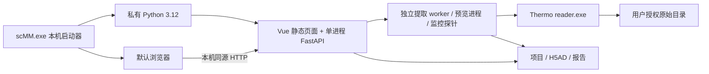

# Windows 适配与软件打包方案

[返回文档索引](README.md) · [安装与部署](installation.md) · [开发指南](development.md) · [实施待办](roadmap.md#windows-适配与内部软件发行)

本文负责 Windows 适配目标、软件分发架构、打包和验收设计；当前安装行为仍以安装说明为准。
用户已选择：**实验室内部使用、本机安装版、浏览器界面，包含完整分析依赖与 Thermo profile RAW**。
产品范围与本方案的执行已获确认；当前已开始 WIN-01 工具实现，尚未通过 Windows 验收，
也没有可供普通用户安装的完整软件包。

## 交付目标与范围

首版交付一个离线安装程序 `scMM-<version>-win-x64-setup.exe`。用户无需自行安装 Python、
Node.js、uv 或 .NET；安装后双击桌面图标，启动本机服务，待就绪后打开默认浏览器。
软件包自带 Python 科学计算环境、已构建 Vue 页面和通过验证的 Thermo helper。
计算与项目保存在本机；AI 助手及数据库下载属于明确启用的联网功能，不阻碍离线科学流程。

| 项目 | 首版建议边界 |
|---|---|
| 操作系统 | 仍在厂商支持期内的 Windows 11 x64 版本，具体版本写入发行验证报告；Windows 10/Server、ARM64、32 位另行验证 |
| 界面与计算 | 复用当前 Vue/FastAPI、应用层及算法；一个 API 服务进程，不改成多个 ASGI worker |
| 分析覆盖 | 打包当前 `web`、`plot`、`cluster`、`supervised` 依赖；已有网页功能逐项验收。尚未接入网页的 Notebook/API 能力不因打包自动成为网页功能 |
| Notebook/API | 保留开发者原有 uv/Notebook/API 安装路线；普通安装包不附 JupyterLab 或开发工具链 |
| 原始谱 | mzML、mzXML、Thermo profile RAW；centroid 与其他厂商 RAW 延续当前限制 |
| 数据库 | 规则 JSON 随包；大体积注释库作为可选、带版本/摘要的离线数据包，不暗中下载 |
| 资源 | 在真实工作负载上测量内存、磁盘与启动耗时，再给出最低/推荐配置和包体大小；不预设实验参数 |
| 运行方式 | 当前 Windows 登录用户下运行，不注册系统服务，不默认开机启动或开放局域网 |

Windows 内部版与现有 Linux 团队服务共享科学代码和项目格式。现有 5006/5007、systemd、
main/dev 发布流程继续服务 Linux 部署，Windows 分发使用独立构建、安装与升级入口。

## 当前代码依据与适配缺口

本次设计核对基于 `dev` 的 `c8b00a8`。这些是代码/锁文件审阅结果，不是 Windows 执行结果。

| 位置 | 当前行为 | 适配要求 |
|---|---|---|
| [pyproject.toml](../pyproject.toml)、[uv.lock](../uv.lock) | Python 3.11–3.12；锁文件列有 PyOpenMS 3.3.0、NumPy 1.26.4、SciPy 1.14.1、H5py、Numba/llvmlite、SHAP、igraph/Leiden 的 CPython 3.12 或 ABI3 Windows x64 wheel | 首版固定经过验证的 Python 3.12 补丁版；核验所选 extras 的完整依赖闭包、wheel 哈希、DLL 加载和实际计算，不以列有 wheel 判断可用 |
| [tasks.py](../scMM/application/tasks.py)、[project_batch.py](../scMM/application/project_batch.py) | 提交明确限制 Linux；锁依赖 `fcntl`，存活判断依赖 `/proc`；子进程使用 `sys.executable -m ...` | 增加平台进程/锁边界，验证持久任务及异常恢复后才能启用 Windows 提取 |
| [projects.py](../scMM/application/projects.py) | 保存锁已有 `msvcrt` Windows 分支，JSON 已采用同目录临时文件和原子替换 | 复用并验证真实跨进程互斥、等待/超时、崩溃释放、文件占用和修订冲突；不把现有分支当成已验收 |
| [thermo_raw.py](../scMM/file/readers/thermo_raw.py) | `selectors` 监听子进程 stdout，默认位置按 Linux 设置 | 替换 Windows 管道读取实现并随包定位 helper；保留完整协议检查及资源回收 |
| [source.py](../scMM/file/readers/source.py) | 使用 `ZoneInfo` 解释 RAW 采集时间 | Windows 发布明确携带 `tzdata`，不依赖间接安装或宿主时区数据库 |
| [auth.py](../scMM/application/auth.py)、[monitor_store.py](../scMM/application/monitor_store.py)、[ai_config.py](../scMM/application/ai_config.py)、[monitor_peer.py](../scMM/application/monitor_peer.py) | 私有文件以 POSIX `0600` 检查和创建 | Windows 改为 NTFS ACL 创建/校验，覆盖 SQLite 日志和旁文件；不能通过跳过权限检查取得兼容 |
| [server_config.py](../scMM/application/server_config.py)、[cli.py](../scMM/api/cli.py) | 默认目录为 `~/.config`、`~/.local/state`；`--show` 在服务启动前开浏览器 | 新增 Windows 目录映射及就绪握手；正常启动保持非交互、失效配置报错 |
| [monitor.py](../scMM/application/monitor.py)、[cell_preview.py](../scMM/application/cell_preview.py) | 监控启动独立 Python 探针，预览使用 spawn 进程池 | 验证显式解释器、工作目录、环境继承、超时和退出；监控不可读仍应阻止升级 |
| [scmm_env.py](../scripts/scmm_env.py)、[ci.yml](../.github/workflows/ci.yml) | Linux/systemd、`.venv/bin`、`/proc`、`/tmp`；当前 CI 为 Ubuntu | 保留 Linux 运维脚本，另建 Windows 构建/升级脚本和 Windows 测试 job |

Python 官方明确指出 Windows 的 selectors 支持 socket、不支持 pipe，这使 RAW 读取适配成为
首要正确性工作，而非仅改默认路径。[selectors 文档](https://docs.python.org/3.12/library/selectors.html)
Windows 缺少系统 IANA 时区库，需显式声明 `tzdata`。[zoneinfo 文档](https://docs.python.org/3.12/library/zoneinfo.html)

## 软件结构与技术选择



建议组合为：**便携 CPython 运行目录 + 普通 scMM wheel + 小型 C# WinForms 启动器 + Inno Setup 安装包**。
启动器只管首次配置、进程、托盘、打开界面和升级入口，科学计算仍在现有 Python 层。
C# 已用于 Thermo helper，可复用构建经验；启动器使用 self-contained 发布，用户不需要系统 .NET。

| 路线 | 评估与取舍 |
|---|---|
| 携带完整 CPython 运行目录（推荐） | 保留普通解释器、`-m` worker、动态导入及科学包布局；Numba/joblib 更接近现有运行模式。代价是包体较大，并需验证运行目录搬迁和 DLL 搜索 |
| PyInstaller onedir | 可做备选 PoC；须适配 frozen 下的 `sys.executable`、worker 分派、资源收集、Numba/joblib 与多进程。不是在当前命令外包一层即可使用 |
| PyInstaller onefile | 首版不采用；大依赖解压、临时目录、子进程和诊断增加验证面，单个安装 EXE 不要求后端也是单文件 |
| 桌面 WebView2 窗口 | 将来可用同一启动器嵌入当前页面；增加 WebView2 运行时分发及导航/下载/关闭行为测试，不是首版依赖 |
| Electron/Tauri、WSL/Docker | 前两者增加桌面工具链，后两者增加最终用户环境要求；当前浏览器形态无需引入 |

便携解释器优先评估 Astral `python-build-standalone` 的 Windows x64 `install_only` 产物，
固定精确构建号、来源及摘要，先验证全部科学依赖。uv 使用这类自包含解释器分发，但这一事实不代表
scMM 打包已经兼容。[Python Standalone Builds](https://docs.astral.sh/python-build-standalone/)

在 Windows 构建机把锁定依赖和 scMM wheel 安装进独立发行解释器；不复制开发 `.venv`，
不依赖开发机绝对路径、可编辑安装或用户 site-packages。普通 venv 不可视为可搬迁发行环境。
[venv 文档](https://docs.python.org/3.12/library/venv.html)
官方 embeddable Python 是另一种分发形态，其常规 pip 管理不受支持，首版不混用这两条路线。
[Python Windows 文档](https://docs.python.org/3.12/using/windows.html#the-embeddable-package)

若便携解释器 PoC 失败，应记录具体不兼容项后再评估 PyInstaller onedir；采用冻结路线时须
重新设计 worker 启动并验证 `freeze_support()`，不能默默切换方案。
[PyInstaller 多进程说明](https://pyinstaller.org/en/stable/common-issues-and-pitfalls.html#multi-processing)

## Windows 平台适配设计

### 任务、锁与进程生命周期

在应用层新增小型平台模块（名称待实现时确定），提供进程启动、身份核对、锁、私有目录及权限能力；
不要把 OS 分支散落到 API/算法。保留现有请求、状态、日志、启动门闩和停止语义，
不把全部分析后台化作为首版前置条件；通用任务演进仍归 M2。

- Linux 保留现有行为；Windows 使用显式解释器路径、参数数组、`shell=False`、独立日志、隐藏控制台及受控环境。
  启动门闩释放前持久化 worker 身份，异常必须留下失败状态。
- 新任务持久化 `PID + create_time + task_id/随机启动标识 + 预期解释器/任务路径`，用 psutil/进程句柄核对；
  不用 PID 单独判断或终止进程，不沿用 `os.kill(pid, 0)` 作为跨平台探针。
  补 worker 心跳辅助定位失联，访问拒绝、身份不明或旧协议状态标记未知，禁止升级。
- 统一任务与项目锁的契约，复用经验证的 `msvcrt` 或采用明确的跨平台锁依赖；规定等待上限和失败提示。
  真实双进程测试竞争、持锁退出和崩溃释放，禁止无锁降级。
- 仍只在当前样本完成后响应“停止后续样本”；已完成产物保留，未成功结果不可纳入。
  刷新和关浏览器不停止任务；Windows 重启后将未完成任务标记 interrupted，显式重试，不承诺从某扫描继续。
- 首版由启动器管理应用进程树。Windows Job Object 用于意外退出时回收受管子进程；
  正常退出先核对未保存工作区与任务，存在阻塞时保留托盘并提示返回处理，不自动保存或强杀。
  强制结束/注销/断电可能中断当前样本，重启后按持久证据恢复状态。

使用 Job Object 时需验证嵌套 job、子进程继承、分配时序和关闭句柄行为，避免误杀其他实例。
浏览器关闭与启动器退出是不同动作；不承诺启动器被强杀后任务仍继续。
[Windows Job Objects](https://learn.microsoft.com/en-us/windows/win32/procthread/job-objects)

### Thermo RAW

保留 `SCMMRAW1` 和 Python 解析器，把平台差异限定在带超时的字节流读取和进程回收。
当前 Windows 适配使用单一 stdout 读取方，通过 `PeekNamedPipe` 查询可用字节再限量读取，
以 monotonic deadline 和短轮询处理等待；只使用 OS 有界管道缓冲，不新增 stdout 预读线程/队列。
stderr 仍由独立线程持续排空。此句柄不能同时由其他线程读取，避免同步管道并发 I/O；
Windows 实测与真实负载吞吐仍待验证。[微软管道说明](https://learn.microsoft.com/en-us/windows/win32/api/namedpipeapi/nf-namedpipeapi-peeknamedpipe)
原设计的有界线程队列保留为必要时的替代方案，不能默默换成无界预读或整文件载入内存。
超时/协议错误先终止 helper，再关闭句柄并限时 join；当前不产生 stdout 线程残留。
结束标记后的 EOF 和退出码仍须核验，不能因拿到结束标记就忽略额外字节或 helper 挂起。

reader 按 `win-x64` **self-contained、目录形式**发布；已有 `reader_command()` 支持直接 EXE，
可显式配置随包路径，DLL + dotnet 形式继续兼容 Linux。无需把 reader 改成 Python 依赖或先转 mzML。
不启用未经验证的 trimming/Native AOT，不为打包改变 float64、参考/异常峰、scan 次序、profile 检查、采集时区或有限值检查。
[.NET 发布方式](https://learn.microsoft.com/en-us/dotnet/core/deploying/)

当前 helper 目标为 `net8.0`。微软公布 .NET 8 支持于 **2026-11-10** 结束；
正式 Windows 包建议在独立里程碑验证并迁移至 .NET 10 LTS，**不能假定 RawFileReader 8.0.42 自动兼容**。
迁移比较同一真实 RAW 的 Linux/Windows、旧/新运行时及既有独立参考报告；
如果迁移未通过，只能形成有明确期限的内部试验包，不宣称正式长期支持。
自包含运行时也必须随软件补丁更新。[.NET 生命周期](https://dotnet.microsoft.com/en-us/platform/support/policy/dotnet-core)

### 路径、保存与权限

安装文件与用户状态分开；采用 Windows Known Folders 获取目录，不硬编码用户名或 `C:\Users`。

```text
%LOCALAPPDATA%\Programs\scMM\
  scMM.exe                         稳定启动入口
  versions\<version>\
    python\                        发行解释器、依赖、scMM wheel 和 Vue 静态资源
    thermo-reader\                 经验证的 Windows helper 与私有运行时
    release.json                   版本、锁摘要、资源摘要、协议版本
    licenses\                      本项目及第三方声明

%LOCALAPPDATA%\scMM\
  config\                          server.json、预设、受保护运维令牌
  state\                           auth/monitor/可选 AI 数据库及主密钥
  cache\  tmp\  logs\              可写运行目录

用户选择的本地数据盘\scMM-projects\   项目与快照
用户选择的原始目录\                 仅引用，不复制
```

此结构为目标布局，尚非当前默认路径。安装阶段只布置程序，首次显式配置才创建用户状态。
使用绝对安装根启动 Python，禁用用户 site、清除外部 `PYTHONPATH/PYTHONHOME` 注入，
隔离 Matplotlib/Numba 缓存；`TEMP/TMP` 和 Python tempfile 初始化顺序须覆盖 worker。
缓存清理继续先提供可审阅计划，不能删除项目引用或活动任务产物。

原始路径覆盖中文、空格、大小写、盘符和受支持 UNC；检查 junction、符号链接和其他 reparse point
解析后的边界。拒绝相对盘符路径、设备路径及不受支持的特殊命名；不能仅靠字符串前缀授权。
长路径既要配置进程声明，也要验证 Python、PyOpenMS、HDF5 和 Thermo DLL；未通过前明确限制并提前报错。
跨 Linux/Windows 重载项目时通过稳定样本 ID 人工重定位原始引用，不盲目替换路径分隔符或盘符。

首版项目、运行数据库与临时产物要求本地 NTFS；网络盘/云同步盘写入另行验收。
远程原始文件只读支持也需验证断连/权限变化；不支持时明确提示用户自行准备本地副本，软件不隐式复制。
保留候选构造、H5AD 关闭后发布、同卷临时文件原子替换、磁盘修订与防覆盖；
外部文件占用或杀毒扫描导致替换失败时，旧清单仍须可读，明确报错而不删旧文件或无限重试。

私有状态目录按当前 Windows 用户 SID 设置 DACL，允许必要 SYSTEM/管理员维护，
拒绝普通其他用户访问；校验继承 ACE、父目录、重解析目标及 SQLite WAL/SHM/日志文件。
把现有 POSIX 权限要求映射为 Windows ACL，不要求 `chmod(0600)` 在 Windows 代表同等安全。
Fernet 用户隔离和主密钥分离保持；DPAPI 可作为后续密钥封装选项，需定义换机恢复，不作为首版必要改造。
[Windows ACL](https://learn.microsoft.com/en-us/windows/win32/secauthz/access-control-lists)

## 启动、首次配置与日常操作

1. 安装器按用户安装，创建桌面/开始菜单入口，不修改全局 Python/PATH，不默认要求管理员权限。
2. 首次由启动器显式进入配置流程：选择原始授权目录、项目根和管理员名；
   调用应用层初始化认证/监控和私有目录，展示一次性凭据位置，沿用首次登录改密流程。
   不预填参考离子等实验参数，不默认暴露整个用户目录。AI 默认不初始化、不联网。
3. 普通启动检查配置与依赖，取得当前用户/安装实例互斥锁，启动一个后端。
   端口由后端实际 bind 后报告给启动器，避免“探测空闲后再绑定”的竞态；可记住上次端口并在占用时重试。
   验证实例 ID、版本和就绪握手后才开浏览器，不仅以 `/health` 为 200 判断是自己的服务。
4. 后端只绑定 `127.0.0.1`，同源提供 API/静态页，保留账号、CSRF、来源及 Host 校验。
   本机 HTTP 显式使用 `cookie_secure=false`；Cookie 名绑定安装/状态实例，避免同主机端口间串会话。
   不将令牌、密码或 API Key 放入 URL；不添加防火墙入站规则。
5. 再次双击只打开已核验的当前实例；启动失败显示可理解的原因及脱敏诊断路径，不反复自重启。
6. 关闭浏览器后服务和任务继续，托盘可重新打开界面、查看状态、打开日志、退出。
   退出/升级复用有效的页面、工作区、任务及请求证据；失联页面和过期证据不判空闲。
   有阻塞时按钮返回处理入口，遵守当前直接执行和状态检查习惯，不加确认复选框或二次确认弹窗。

多 Windows 用户各自拥有状态及项目授权；首版同一用户仅一个运行实例，发布测试环境使用独立状态与 Cookie。
“Windows 上单机运行”不等于取消网页认证；若未来需本机免密码模式，须另行设计和确认。

## 构建、安装与发行流程

### 可追溯的离线构建

Windows 专用构建入口与发行清单放在 `packaging/windows/` 和 `scripts/build_windows.py`；
目前只实现下文 WIN-01 输入与运行环境 PoC，完整安装器构建仍待后续里程碑，
不让 Linux `scmm_env.py release` 承担安装包构建。

1. 从明确 Git tag/提交构建，记录工作区洁净状态；发行版本统一来自 Python 包版本，
   同步前端发行标识、启动器产品版本和清单，避免目前 Python/前端版本分别被误认作发行版本。
2. Windows 原生 runner 上固定 Python、uv、Node、.NET SDK、安装器版本；
   使用 `uv.lock`、npm lock、NuGet lock，打包额外工具单独锁定，不执行全依赖升级。
3. `npm ci` 后构建 Vue 静态资源，再构建 scMM wheel；仅安装运行 extras，
   普通 wheel/sdist 继续供 API/科研开发者使用，桌面安装包属于独立发行产物。
4. 按锁文件解析 Windows 完整依赖闭包，建立带 SHA-256 的 wheelhouse；
   原生包要求已审阅的 wheel，缺失时构建失败并记录，不临时在用户机器编译或改变算法。
   用固定便携解释器离线安装依赖及 scMM wheel；所有安装动作发生在构建期。
5. 构建启动器和 Thermo helper，自包含发布；携带必要原生运行库或其合法离线安装依赖，
   通过无 Python/.NET/开发工具的干净虚拟机确认，不能把“自包含”理解为无需验证系统原生依赖。
6. 将完整目录复制到不同路径和不同用户下验收，检查无构建机绝对路径、editable 引用、
   全局环境依赖或首次运行下载。检查规则、静态资源、DLL、CA 证书和时区数据完整性。
7. Inno Setup 包装目录、快捷方式、卸载和升级入口；发布安装包、SHA256SUMS、发行说明、
   依赖/SBOM 清单、第三方声明、安装/数值验证报告。大型数据库另列版本和许可，不捆绑真实实验数据。

Inno Setup 支持非管理员按用户安装；商业用途须重新核对其当期许可政策，
内部科研分发也应保留工具及所打包依赖的许可声明。
[权限配置](https://jrsoftware.org/ishelp/topic_setup_privilegesrequired.htm)、[许可政策](https://jrsoftware.org/isorder.php)

### 内部分发和升级回滚

首版通过实验室受控共享目录/内网下载页提供**完整离线安装包**，采用版本号和 beta/stable 通道。
更新检查默认关闭，用户主动安装新版；不做后台自动下载、pip 热更新或强制重启。
正式推广建议给自有启动器/安装器签名并加时间戳；证书和发布身份另行配置。
少量内部试验可明确标记未签名并用受控渠道校验摘要，不能把摘要当作发布者签名或承诺签名消除所有 SmartScreen 提示。

升级先暂存新版本并校验清单，再核对当前服务新鲜状态；有活动/失联页面、未保存工作区、任务、在途请求
或未知证据时停止切换。就绪后退出旧版，完成必要迁移，启动并核验新版，成功才更新版本指针。
保留上一版；健康检查失败恢复旧代码/运行环境。处理断电、磁盘不足、文件占用和安装中断，
避免安装器绕过启动器状态检查直接覆盖使用中的文件。

项目数据不随升级回滚；有认证/配置数据库 schema 迁移时，在停止写入后完成一致性备份并声明回退兼容范围，
不可仅回退代码并让旧版读不兼容数据库。项目格式若不可逆升级，保留旧项目快照并显式限制旧版打开。
卸载只删除程序和快捷方式，保留原始数据、项目、账号配置和密钥；数据清理由独立可审阅计划承担。

### 再分发边界

仓库根目前未发现 LICENSE/COPYING。首个内部发行包需明确本项目及参考代码的授权范围，
核查 Python 科学依赖、原生 DLL、运行时与数据库的实际许可；内部使用也不能直接推定可任意再分发。
Thermo DLL 的再分发条件必须按所用 NuGet 版本随附条款核对，保留原文和履行记录；
不能由“可下载/可安装 NuGet”推导有权随软件分发。
[Thermo 官方仓库](https://github.com/thermofisherlsms/RawFileReader)、[官方许可文件入口](https://github.com/thermofisherlsms/RawFileReader/blob/main/License.doc)
若条件未核清，可先交付不含厂商 DLL 的适配试验包并允许管理员配置合法 reader，
但该包不能标记为已完成用户要求的 Thermo RAW 离线交付。

## 验证矩阵与实施里程碑

验证分为 Linux 回归、Windows 合成检查、干净机器安装、真实 RAW 对照和用户验收；
分别记录，不能用本机导入、模拟无 `fcntl` 或 CI 通过代替真实 Windows RAW 验收。

| 编号 | 交付内容 | 退出条件 |
|---|---|---|
| WIN-01 | Windows 依赖与便携解释器 PoC | 选定 extras 完整安装；PyOpenMS/H5py/Numba/SHAP/聚类各自真实最小计算；全目录搬迁、中文用户、无网络及无系统 Python 下运行，记录 DLL/VC 依赖、包体与耗时 |
| WIN-02 | 平台任务、锁、路径、权限与配置 | Windows 真实 worker/预览/监控；重复提交/跨进程互斥、PID 复用/身份未知、崩溃/重启、停止后续样本、状态恢复、ACL 与越界防护通过；Linux 相关块不退化 |
| WIN-03 | Windows RAW 管道和运行时验证 | 合成截断/慢流/大 stderr/超时/异常退出/队列取消及句柄回收；真实 profile RAW 同参数跨平台和新旧运行时对照，centroid 拒绝；Thermo 许可核清 |
| PKG-01 | 本机启动器与首个离线安装包 | 非管理员安装、显式首次配置、登录改密、端口冲突/重复双击、关浏览器继续提取、托盘退出保护、无开发环境启动通过 |
| PKG-02 | 升级、回滚、内部发布与整体验收 | 有活动/未知状态拒绝升级；安装中断/文件占用/磁盘不足/新版失败回滚；卸载保数据；整条网页流程、报告下载、保存重载及 Linux↔Windows 原始路径重定位由用户验收 |

顺序为 `WIN-01 → WIN-02/WIN-03 → PKG-01 → PKG-02`；任务与 RAW 适配可分开实现，
但完整离线 RAW 安装包需二者均通过。M1/M2 的既有优先级保持，Windows 先保障现有提取链，
不等待所有分析完成通用后台化，也不顺带扩大科学算法范围。

未来 CI 保留 Linux Python 3.11/3.12；新增 Windows Python 3.12 必跑相关领域/应用/API 块，
Linux 运维专属测试明确分类，Windows 平台专项不能 skip。跨平台测试中的 Python 可执行路径、
临时目录、信号和 UTF-8 使用实际平台 API；新增模块纳入现有分块映射。
安装包 job 使用固定 Windows 镜像和独立干净 VM，浏览器验证实际安装后的服务；
内部真实 RAW 在有授权数据的受控 Windows 环境运行，不上传谱文件/矩阵到公共 CI。

数值对照使用同一输入、冻结参数、seed 和依赖版本：协议原始 float64 数组要求无损，
确定性处理比较形状、稳定 ID、有限值及适用的数值误差；跨 BLAS/线程的结果记录明确容差。
随机嵌入/聚类不默认要求图形逐点一致；容差、样本选择与规模须在实验前确定，不能凭设计稿猜测。
保存/恢复失败检查旧清单、旧矩阵和已完成样本仍有效。

工作量应在 WIN-01 后按实际阻塞重新评估，首版不承诺未测量的工期、安装包大小或最低内存。
本方案完成不表示以上里程碑已实现、实验通过或获发布授权。

## WIN-01 当前工具与执行方式

此节是开发者 PoC 操作，安装器、托盘、Windows 任务/ACL 和 RAW 适配仍未实现。
工具不会启动网页服务或初始化账号，不会调用 Linux `release`，也不构成发行/许可验收。

[runtime.json](../packaging/windows/runtime.json) 固定候选 CPython **3.12.13 / 20260807**、
Windows x64、uv **0.12.3**、四组运行 extras 和 Python 归档摘要。
解释器摘要来自该构建的 GitHub Release asset `digest`，下载时再次计算 SHA-256；
这是来源与完整性核对，不表示其 DLL 或科学计算已通过 Windows 验证。
`web` 明确声明 Windows `tzdata`，不依赖 pandas 间接携带。

### 输入准备（Linux 或 Windows 构建机）

在独立构建 checkout 使用仓库的锁定开发环境；不要在服务正在使用的 `.venv` 中同步构建依赖。
`packaging` 由现有 `build` 开发依赖提供。
固定 uv 版本后运行下列命令，输出目录必须尚不存在。`audit` 不修改锁文件，
也不更新任何依赖；`download` 仅按清单获取构建输入，不安装到当前环境。

```bash
uv sync --locked --only-group dev
uv run --no-sync python scripts/build_windows.py audit --output .tmp/windows-poc/inputs
uv run --no-sync python scripts/build_windows.py download --inputs .tmp/windows-poc/inputs
```

`audit` 用 `uv export --locked` 导出 `web/plot/cluster/supervised`，按目标 Windows 标记、
CPython/ABI 与 wheel 平台标签选择每包一个兼容 wheel；缺 wheel、版本歧义或缺少必需科学包时失败。
不接受 sdist 或本地编译替代。清单保留 Git HEAD、工作区是否有修改、pyproject/uv.lock 摘要、
每个 wheel 来源/版本/摘要及解释器来源/构建号。`requirements.txt` 携带所选 wheel 哈希，
`pylock.windows.toml` 保留完整导出依据。

`download` 逐个复核已有缓存和新下载，临时文件验证成功后才发布；损坏缓存明确报错，
不会自行覆盖。输入不完整时不能组装，下载失败也不写为 Windows 验收成功。
网络受限时可在允许联网的构建机运行同一命令，再完整复制 inputs 目录；不关闭 TLS 校验。

### Windows 原生离线组装

在 Windows x64 构建机准备同一份仓库、固定 uv、锁定开发环境、上述 inputs 和 scMM wheel。
wheel 须由完整构建产出并包含 Vue 静态页面及规则 JSON；前端构建方式沿用
[开发检查](development.md#完整验证)，`uv build --wheel --no-sources` 构建 Python wheel。
不得使用 editable 安装或复制开发 `.venv`。

```powershell
uv run --no-sync python scripts/build_windows.py assemble `
  --inputs 'D:\scMM-build\inputs' `
  --wheel 'D:\scMM-build\dist\scmm-0.2.0-py3-none-any.whl' `
  --output 'D:\scMM PoC\runtime'
```

输出必须为新目录；工具拒绝非 Windows x64，复核输入摘要与便携解释器版本，
安全解包后仅用本地 wheelhouse、`--offline --no-index --require-hashes --only-binary` 安装依赖，
连同指定 scMM wheel 的四组 extras 一起解析安装并执行 `uv pip check`。
安装 requirements 从清单重新生成，不信任被改动的导出文本。wheel 自身摘要另记入 `poc.json`；
这是显式传入的构建产物，不声称其必然对应清单中的干净提交。
组装失败保留诊断目录，未写出 `poc.json` 的目录不得作为可验证产物使用；改用新目录重试。

### Windows 11 电脑的离线验证包

用户已选择在自己的 Windows 11 电脑执行。为避免要求该电脑预装构建工具，
`scripts/build_windows.py kit` 将已校验 inputs、scMM wheel、固定 Windows uv、
引导/验证脚本及许可声明封装为 `scMM-WIN01-win-x64.zip`。
uv 来源/摘要固定在 [build-tools.json](../packaging/windows/build-tools.json)，
版本必须与运行输入一致；归档清单逐文件记录摘要，ZIP 另生成 `.sha256`。
该 ZIP 是科学运行环境验证工具，包含构建输入，不是 PKG-01 安装程序，也不包含 Thermo DLL。

```bash
uv run --no-sync python scripts/build_windows.py kit \
  --inputs .tmp/windows-poc/inputs \
  --wheel .tmp/windows-poc/dist/scmm-0.2.0-py3-none-any.whl \
  --uv-archive .tmp/windows-poc/uv-windows.zip \
  --output .tmp/windows-poc/scMM-WIN01-win-x64.zip
```

`--uv-archive` 必须是固定来源的原始 Windows ZIP，先按 build-tools 清单下载并核对，
kit 命令还会再次校验。不会从当前机器收集 `.venv`、用户设置或实验数据。
包内 [README 原文](../packaging/windows/WIN01-README.txt) 为用户执行说明：
校对 ZIP 摘要后，只针对可信 ZIP 执行 `Unblock-File`（如有下载标记），完整解压，
断网后在解压目录的 64 位 PowerShell 执行：

```powershell
powershell.exe -NoProfile -ExecutionPolicy RemoteSigned -File .\run-win01.ps1 -WorkRoot D:\scMM-WIN01-run1
```

`RemoteSigned` 仅适用于这次进程；组织策略仍有效，遇到阻止应遵循本机管理策略。
`WorkRoot` 必须为新的本地 NTFS 目录，也可省略，默认在 Known Folder 的 LocalAppData 下
创建带时间戳的独立目录。入口先核对完整文件摘要，再用系统 tar 解开已校验 Python，
从已校验的纯 Python packaging wheel 引导组装程序，不要求预装 Python/uv/.NET/Node 或管理员权限。
所有依赖安装均发生在新建私有运行目录；不改变系统 PATH、账号或项目。

入口自动运行原位置计算，将完整运行目录搬入中文与空格路径，再运行同一计算。
成功和运行阶段失败均保留 `session.json`、`diagnostics.txt` 以及已生成的 `before.json`/`after.json`；
输入核对或目录预检失败时控制台说明原因，不预造计算报告。请返回这些小文件和 Windows 版本、
实际断网方式、是否已有开发工具的说明；诊断可能带本地目录名，发送前自行检查。
现有开发电脑通过不能替代干净机验收，目录搬迁也不能替代另一个中文 Windows 账号实测。
Python 网络钩子不会约束原生 DLL，`session.json` 不把断网条件自动判为通过。

### 干净机器与搬迁检查

复制组装目录到没有 Python/.NET/Node/uv 的 Windows 11 x64 测试机。
断开网络后，用随目录携带的脚本调用私有解释器；无需安装构建工具。
脚本清理 Python/uv 环境注入，设置独立 TEMP/TMP、Matplotlib/Numba 缓存，传递 `-I`。
如本机策略不允许运行 PowerShell 脚本，按实验室策略配置，不要求关闭系统保护。

```powershell
& 'D:\scMM PoC\runtime\validate-runtime.ps1' `
  -Runtime 'D:\scMM PoC\runtime' -Report 'D:\scMM PoC\before.json'
Move-Item -LiteralPath 'D:\scMM PoC\runtime' -Destination 'D:\中文 搬迁\runtime'
& 'D:\中文 搬迁\runtime\validate-runtime.ps1' `
  -Runtime 'D:\中文 搬迁\runtime' -Report 'D:\中文 搬迁\after.json'
```

目的父目录须先创建且目标不能已存在；在另一个 Windows 用户下重复复制与验证，
记录操作系统版本、用户/目录条件、断网方式、原生 DLL/VC 运行库诊断及失败信息。
报告不能覆盖已有文件；不要把仅改变目录称为已通过中文用户验收。

验证包括 NumPy/SciPy 求解和 scMM 归一化、float64 AnnData/H5AD 中文路径往返、
PyOpenMS mzML 往返、Numba JIT、SMOTE/SHAP 加和、igraph/Leiden 与 UMAP、
Matplotlib 输出、Vue/规则资源和时区数据库。报告记录解释器、OS、包版本、
清单/验证脚本摘要、分项结果、耗时、Windows 峰值工作集和展开体积；临时科学产物自动清理。
Windows 下检查解释器版本、完整锁定包版本、非 venv 和 Python 搜索路径边界。
Python 审计钩子拒绝 Python 网络调用，但不能限制原生 DLL，实际离线条件仍须测试机断网。

Linux 可用 `--allow-non-windows` 调试验证脚本；报告始终保留
`native_windows_x64=false`，不能作为 WIN-01 退出依据。
以上六组计算不替代完整领域/应用/API 回归、安装验收或真实 RAW；
WIN-01 必须补齐原生 Windows、搬迁、中文用户、干净机和离线证据后才能关闭。

### 首轮实机失败与小型诊断

2026-10-18 收到的 Windows 11 / Python 3.12.13 报告显示：77 包离线组装和依赖检查完成，
H5AD/归一化、Numba、SMOTE/SHAP、igraph/Leiden/UMAP 和绘图资源五组计算通过；
PyOpenMS 3.3.0 的 `MzMLFile.store` 无法创建中文父目录/文件名下的 mzML，搬迁阶段尚未执行。
这是已观察到的路径失败，不能仅凭错误文本判为所有 DLL、解析器或用户目录权限有问题。
该电脑的 PATH 可发现 Python/Node/.NET 命令，不能作为无开发工具的干净机证据；断网尚未单独确认。
摘要和原始附件摘要见 [首轮实机记录](validation/windows-win01-native-first-run.json)。

[diagnose_windows_openms.py](../scripts/diagnose_windows_openms.py) 可直接用已经组装的私有 Python 执行，
无需重装或重新下载完整 ZIP。它分别检查 ASCII、中文文件名、中文父目录、二者组合，
区分 Python 文件 I/O + 小型 XML buffer 数值往返、OpenMS 直接写入和读取，以及 str/UTF-8 bytes/ACP bytes。
同时记录 Windows ANSI 代码页与临时根是否 ASCII；不改变系统区域设置、依赖或原运行目录。
buffer 仅用于极小合成诊断，**不是把真实原始谱整文件读入内存的生产兼容方案**。

```powershell
& '<原运行目录>\runtime\python\python.exe' -I .\diagnose_windows_openms.py --report .\openms-path-report.json
```

下载脚本后在其所在目录运行，替换原运行目录为已有诊断目录。生成新的小型 JSON，
失败项独立保留，`diagnosis_completed` 只表示诊断执行完毕，不代表全部检查通过或 WIN-01 验收通过。
在补齐定位及实际路径修复证据前，不关闭中文路径门槛、不升级依赖，也不要求用户重命名原始谱。

### 进程级 UTF-8 候选修复复测

后续实机诊断显示系统 ACP 为 **936**：ASCII 全通过，中文路径的 `str`/UTF-8 bytes
直接读写失败，ACP bytes 写入成功但读取仍失败；Python I/O 与小型 buffer 解析全部通过。
这排除了“只改为 CP936 bytes”作为完整修复方案，记录见
[路径诊断摘要](validation/windows-win01-native-path-diagnosis.json)。

候选方案是在 **scMM 私有 Python 副本**的已有 PE manifest 中加入
`activeCodePage=UTF-8`，统一该进程的原生窄字符串代码页；保留原有身份、安全、兼容性和长路径声明。
微软文档说明 Windows 1903 起支持此进程设置，Windows 11 在目标范围内；
它与单纯 Python `-X utf8` 不同，不要求修改系统区域设置。
[微软进程 UTF-8 文档](https://learn.microsoft.com/en-us/windows/apps/design/globalizing/use-utf8-code-page)
用户随后返回 Windows 实机结果：28 项路径探针、六组计算及中文空格目录搬迁前后全部通过，
原始 EXE 摘要保持一致；见 [原生 UTF-8 通过记录](validation/windows-win01-native-utf8-pass.json)。
因此已接入默认离线组装：只修改随包的、已验证来源且无签名的私有 Python，记录资源与 EXE 摘要，
启动时必须确认 ACP=65001，再安装锁定依赖。用户系统 Python 和系统区域设置不修改。

[probe_windows_utf8.py](../scripts/probe_windows_utf8.py) 配合原诊断和科学计算脚本形成小型复测包，
使用已有私有 Python 执行：

```powershell
& '<原运行目录>\runtime\python\python.exe' -I .\probe_windows_utf8.py --runtime '<原运行目录>\runtime'
```

工具仅接受该候选构建的原始 `python.exe` SHA-256，拒绝有证书的 EXE、链接/junction 和已有输出目录。
默认在原运行目录旁创建新的 `utf8-trial-<时间>`，完整复制运行目录，保留原环境和证据，
只更新副本中已有 manifest 的所有语言资源，并记录前后摘要。至少检查两倍当前运行目录体积的
可用空间，为副本和临时计算留出余量；这是探针空间检查，不是安装程序的最低配置。

随后用副本解释器检查 ACP 确为 65001，执行全部路径探针，再执行六组科学计算，
将副本整体搬入中文空格目录后再次执行六组计算。每步失败即保留诊断并停止，不使用 buffer
替代生产文件路径接口，不升级科学依赖。输出 `utf8-probe.json`、`openms-utf8-report.json`、
`before.json`、`after.json` 及 `diagnostics.txt`；返回已生成的小文件即可。
该候选仍须用户断网复测、审阅新报告，并验证干净机/中文账号；不将资源编辑或 Linux XML 测试标为 Windows 修复通过。

## 源码与 wheel 的共同 Windows 运行边界

用户要求原仓库与打包产物同时支持 Windows。进程 UTF-8 不能只在测试脚本中生效：
正式打包组装已固定这一配置；源码使用独立开发解释器，所有入口和子进程共享同一进程编码及源码身份。
普通系统 Python 的 `-X utf8` 不等于原生 ACP=65001，不能用它冒充已验证环境。

### 源码运行入口

仓库新增 [scmm_windows.py](../scripts/scmm_windows.py)。从已验证/已组装的 UTF-8 私有环境准备独立副本：

```powershell
python scripts/scmm_windows.py prepare --from-runtime '<已有 UTF-8 环境>\runtime'
python scripts/scmm_windows.py run -- -m scMM.cli --help
python scripts/scmm_windows.py run -- -m scMM.api.cli --help
python scripts/scmm_windows.py run -- -m scMM.api.admin_cli --help
```

若机器没有系统 Python，用已有私有环境的 `python\python.exe -I` 执行上述脚本即可。
默认开发解释器为仓库 `.tmp/windows-source/runtime/python/python.exe`；可用 `--runtime` 选择新的独立位置。
`prepare` 校验进程 ACP、私有 prefix、种子 lock 摘要、链接/junction、磁盘空间和防覆盖，
复制完整依赖环境后通过只存在于开发副本中的 `.pth` 绑定当前仓库。
这使 `-m` worker、spawn、API、CLI 和直接 Python 调用均加载同一源码；不复制开发环境进入发行包。
`run` 清理外部 Python/uv 注入，检查实际 scMM 文件身份及 pyproject 摘要，再用 `-I` 执行所给 Python 参数。
依赖/版本改变或仓库搬迁后需重新准备，不能静默落回系统或 wheel 中的旧代码。

`load_single_file`/`save_spectra` 在不兼容的 Windows 进程遇到中文 XML 路径时会提前给出明确编码提示，
不再误报 XML 损坏，失败不创建输出目录；Linux 行为保持。文件路径和原始浮点数仍直接交给 OpenMS，
没有引入整文件 buffer、原始数据复制或系统区域设置修改。

### 源码与 wheel 独立复核

`build_windows.py delivery --wheel <当前wheel> --output <新ZIP>` 生成小型复核包，
逐项核对 scMM 源文件/资源与 wheel 一致，包含源码快照、wheel 和开发/验证入口，不含实验数据或开发 `.venv`。
其验证入口使用现有已通过的 UTF-8 环境作为种子，分别复制出 wheel 与源码环境，
仅在 wheel 副本中离线安装当前 wheel，再把源码副本绑定到中文目录中的实际仓库代码。

```powershell
& '<已有 UTF-8 环境>\runtime\python\python.exe' -I .\validate-delivery.py --runtime '<已有 UTF-8 环境>\runtime'
```

复核默认写入系统临时目录下的 `sd-MMDD-HHMMSS`，不再嵌套在已搬迁的种子旁；
运行时副本使用短目录名，搬迁目的地仍含中文和空格。复制前按 UTF-16 长度检查全部已有
运行时/源码文件及计划搬迁目标，保守限制文件路径 259、目录路径 247 单位，超限直接提示
使用 `--output <更短的新目录>`；源码 `prepare` 同样检查 `--runtime` 目标。
不依赖管理员修改注册表，也不把本次检查当作任意长路径支持证明。
用户首轮双入口复核在复制阶段出现 88 个 260–276 单位的目标路径失败，尚未执行科学检查，
见[复制失败与修复记录](validation/windows-delivery-path-copy-failure.json)。限制依据
[Microsoft 路径长度说明](https://learn.microsoft.com/en-us/windows/win32/fileio/maximum-file-path-limitation)。

两者分别检查实际代码摘要、三个 CLI 的帮助入口，以及 API 的 mzML 保存/读取、显式 64-bit mzXML 输入、
原有六组科学计算与新增 RAW 合成管道检查；各自搬入中文空格目录后重复计算。
RAW 检查覆盖短流、结束标记后额外字节、大 stderr、超时和进程/线程回收，不调用真实 Thermo DLL。
返回 `delivery-report.json`、`wheel-before/after.json`、`source-before/after.json` 和日志。
`checks_passed` 只表示这组检查成功，不代表完整 Windows 网页/后台任务/RAW/安装器通过。
2026-10-18 用户返回 v2 总报告：`status`、`wheel` 和 `source` 均为 `checks_passed`，
源码/wheel 摘要与交付清单一致，运行时计划复制/搬迁路径最长 188 UTF-16 单位。
随后补齐的四份细项报告全部为 `passed`，每份七组检查均通过，共 28 次组检查；
验证脚本摘要与交付包一致，76 个锁定 wheel 版本均匹配，四次包版本集合与输入身份一致。
wheel 原位置/搬迁后耗时 **27.125s / 24.313s**，源码为 **26.250s / 23.453s**，
峰值工作集 **530,116,608–531,279,872 bytes**；只是本次运行观测，不作性能基准。
源码从中文仓库目录加载，wheel 从各自 site-packages 加载；两套运行时完成搬迁，
源码目录本身未搬迁，不能把本次结果写成源码仓库搬迁后重新绑定已验证。
实际 OS 断网、真实 RAW、完整网页和干净机检查仍需独立证据。
证据见[双入口实机记录](validation/windows-source-wheel-native-pass.json)。
认证 NTFS ACL、任务/锁/恢复/监控、真实 RAW 与 helper、干净机/中文账号和整条网页流程仍是必做门槛。

## Windows Codex 交接起点

本节供 Windows 开发机继续本轮工作。用户于 2026-10-18 要求整理、提交并推送 `dev`，
再由 Windows 上的 Codex 接手；该请求是开发交接，不是完整 Windows 验收或 Linux 生产发布。
Linux `main` / 5006 生产服务不在本次交接操作范围。新会话先核对实际分支、工作区和可用工具，
阅读根目录 `AGENTS.md`、本文及 [roadmap 的 Windows 里程碑](roadmap.md#windows-适配与内部软件发行)。
本文的方案与此前授权沿用，常规实现步骤无需再次询问；实验参数、真实验收结论和发布范围不能推断。

### 已完成的基础与证据

- 私有 CPython 3.12.13 x64、uv 0.12.3 和 76 个锁定科学/网页依赖 wheel；构建配置在
  `packaging/windows/runtime.json`、`build-tools.json`，不使用系统 Python 安装科学依赖。
- 私有解释器原生进程 `activeCodePage=UTF-8`；源码入口与打包运行时共用这一边界。
  `-X utf8` 或环境变量不能替代原生 ACP。原始种子保留，补丁只用于私有副本，不修改系统区域设置。
- 用户 Windows 11 上 28 项路径探针通过；后续源码/wheel 两套独立运行时搬迁前后，
  各七组合成检查全部通过。源码目录为中文路径，已安装 wheel 的模块位于私有 site-packages，
  没有将已安装旧代码误当作源码。完整脱敏报告及附件摘要已入 Git，见
  [双入口实机记录](validation/windows-source-wheel-native-pass.json)。
- Windows RAW stdout 使用单读取方 PeekNamedPipe；合成协议、超时、大 stderr 和资源回收通过。
  真实 Thermo reader、真实 RAW 与 .NET 分发尚未完成。Linux 原有 selectors 保留。
- 旧复核目录过深导致 WinError 3；v2 改为短目录，并检查复制及搬迁目标长度。
  不以启用系统长路径或删除依赖文件绕过；任意长路径支持尚未验证。

### Windows 接手时的第一步

将仓库放在较短位置，检出远端 `dev`；已有仓库先检查未提交内容，再正常快进更新，
不要 reset/clean 覆盖用户文件。交接提交号由本次交接消息提供，旧报告中的 dirty/commit
是当时构建身份，不能直接用旧报告证明更新后的代码通过。

用户已通过的原生 UTF-8 种子通常仍在下列位置；先检查实际文件存在，不覆盖种子。
下面从该种子为新仓库创建独立源码环境，目标必须尚不存在，必要时选另一个短名称：

```powershell
$seed = "$env:LOCALAPPDATA\scMM\win01-20261018-113559\utf8-trial-20261018-114857\中文 relocation\runtime"
$privatePython = Join-Path $seed 'python\python.exe'
$sourceRuntime = "$env:LOCALAPPDATA\scMM\source-dev-1018"
Test-Path $privatePython
& $privatePython -I .\scripts\scmm_windows.py prepare --from-runtime $seed --runtime $sourceRuntime
& $privatePython -I .\scripts\scmm_windows.py run --runtime $sourceRuntime -- -m scMM.cli --help
& $privatePython -I .\scripts\scmm_windows.py run --runtime $sourceRuntime -- -m scMM.api.cli --help
& "$sourceRuntime\python\python.exe" -I .\scripts\validate_windows_runtime.py --source-root . --report .\source-check-new.json
```

最后一个报告路径必须为新文件。确认源码模块位置、ACP=65001、私有 prefix 和锁摘要，
再开始平台修改。仓库移位后重新 `prepare`，不复制旧 `.pth` 充当新绑定；补做仓库本身
搬迁后的重新绑定测试。种子只含运行依赖，**未提供 pytest/ruff 等开发工具**；
需要测试时，按当前 `uv.lock` 的 dev 组另行准备开发依赖，不升级锁、不污染原种子，
也不要把未验证 ACP 的系统/venv 解释器当作原生中文路径基线。

### 继续执行的顺序

1. **WIN-01 补齐环境门槛**：源码仓库搬迁后的重新绑定；实际 OS 断网，干净机器和中文账号。
   当前网络 audit hook 只能限制 Python 网络行为，不能证明原生 DLL 不出站。
2. **WIN-02 平台边界优先**：检查 `application/auth.py` 的权限保护与 NTFS ACL，
   `application/tasks.py` 的 fcntl/锁、`/proc`/PID 身份及退出恢复，
   `application/monitor.py`、`monitor_probe.py` 的探测与未知状态。
   路径、Known Folders、spawn、首次配置和凭据隔离同样纳入；单 API 进程和认证要求保留。
   先建立 Windows 真进程基线，再实现并验证互斥、崩溃恢复、PID 复用/权限不足及未保存状态。
   禁止以跳过平台专项、取消权限/锁检查或将未知判为空闲来获得通过。
3. **WIN-03 真实 reader**：按 [RAW 技术说明](thermo-raw.md) 核对 helper 的 Windows 构建、
   .NET LTS/自包含路线和 Thermo 许可/再分发条件，再做真实 profile RAW 对照。
   不把合成协议成功当作真实 RAW 成功，不猜实验参数或容差，不降精度或隐式转格式。
4. **PKG-01 → PKG-02**：依照本文设计实现 WinForms 启动器/托盘、浏览器同源单进程服务、
   Inno Setup 离线安装、首次账号配置、重复启动/端口/退出保护，随后完成升级、回滚、卸载保数据
   和整条网页保存/重载流程。当前没有最终安装器，不先宣布可交付。

每个可独立验收的里程碑运行相关 Windows 测试，记录环境/源码身份、真实或合成范围、失败恢复
及未完成边界；继续维护 CHANGELOG、roadmap 和主题文档。Linux 服务脚本 `scripts/scmm_env.py`
不是 Windows 部署入口；Windows 会话不操作 Linux 5006/5007。不要为了 Windows 适配破坏 Linux
回归，需要 Linux 环境的检查留给对应机器执行并明确记录未运行。后续提交/发布遵循当前授权与 AGENTS。

### Git 外交付物

二进制依赖与临时归档不提交 Git；Windows 现有种子可继续复用。若需要重新获取，
由用户从本次会话已有交付文件传递，不能假定克隆仓库会带有这些文件。

| 文件 | SHA-256 | 用途 |
|---|---|---|
| `scMM-source-wheel-check-v2.zip` | `e5cee042198f497a85a8872e671a20b515f9a897385c5a6baff1f36a5ba51ef5` | 已通过的源码/wheel 对照复核快照，非当前仓库持续开发入口 |
| `scMM-WIN01-win-x64-utf8.zip` | `73a749a509b786f4144b480374bcd078626cb0fa0e65f4df010073e03b2ba521` | 完整离线验证输入，包含默认 UTF-8 组装工具；该完整新组装入口尚未重新实机验证 |

重建工具是 `scripts/build_windows.py audit/download/assemble/kit/delivery`；命令及边界见
[当前工具说明](#win-01-当前工具与执行方式)。旧归档按摘要留存；修改代码后构建新 wheel，
重新核对源码/资源一致性，并生成新名称的包和报告，不覆盖已经通过的证据。

## 后续扩展

如果之后需要独立桌面窗口，可在同一启动器加 WebView2，仍使用本机同源 HTTP 和现有 Vue；
限制导航到本机实例，外链交给系统浏览器，不向页面暴露通用命令执行桥。
需携带/检测独立 WebView2 Runtime，离线环境用完整运行时安装器，不能假设安装 Edge 浏览器就满足要求。
[WebView2 分发说明](https://learn.microsoft.com/en-us/microsoft-edge/webview2/concepts/distribution)
Windows 多人服务器、公开/商业发行、自动更新和 macOS 各自作为独立后续范围，不改变首版内部单机目标。
